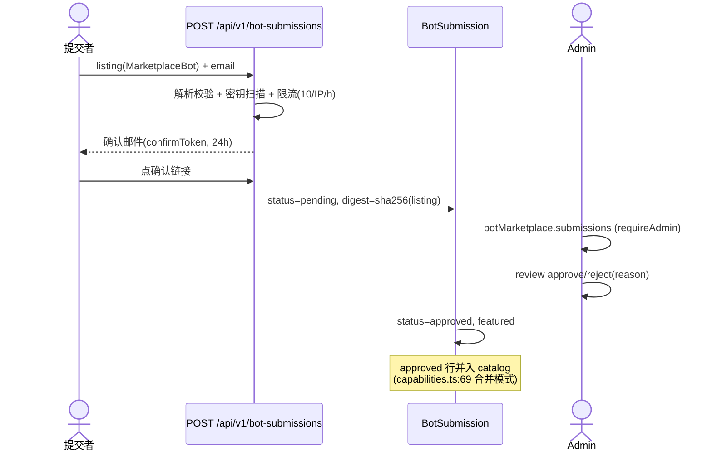
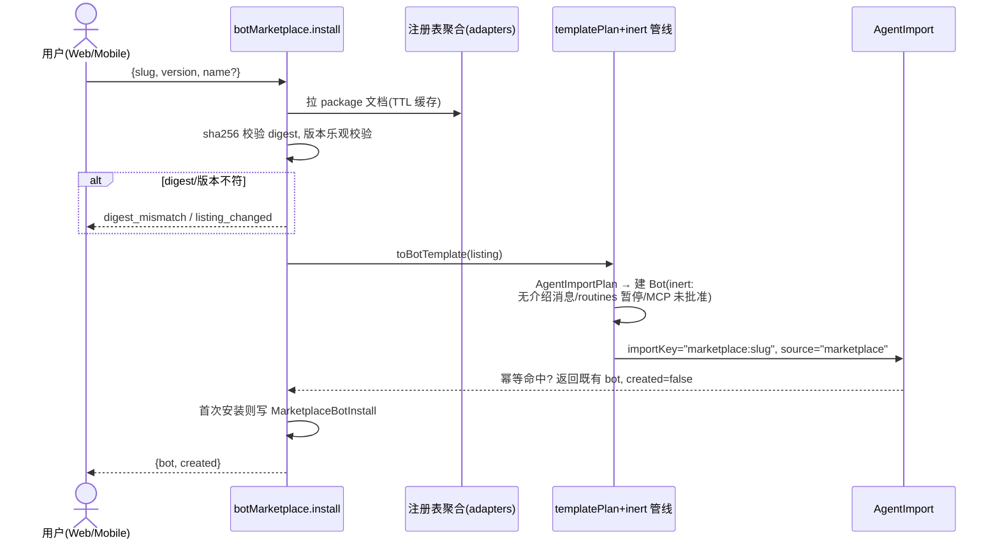

# Botone Bot 市场设计方案

日期：2026-11-12。前置输入：[bot-marketplace-survey.md](./bot-marketplace-survey.md)（仓库实测勘察，所有 botone 侧断言的路径证据见该报告）。本设计只新增模块，不修改现有行为（见 §10 复用 vs 新增清单）。

---

## 1. 目标与范围

**目标**：为 botone 建一个 Bot 市场——用户可浏览、预览、一键安装现成 Bot（人设 + 技能 + 例程 + 应用依赖），第三方可提交 Bot 上架、管理员审核。参考 Grok Bot 市场与 OpenMausBot Team Library，但所有对接点落在 botone 现有管线上。

**范围内**：市场目录（外部注册表聚合 + 官方审核上架）、商品声明格式、安装流（复用 inert 管线）、提审流、版本更新、安全策略、分阶段实施。

**范围外（远期才考虑）**：评分/评论、支付分成、多 Bot 团队包、私有组织目录。这些在勘察报告 §4 已确认 botone 无任何现存基础，全部标为新增。

---

## 2. 三市场对比

### 2.1 Grok Bot 市场（xAI）

> ⚠️ 假设标注：外网未直接访问。以下基于两类代码事实：(a) botone 已对接的 xAI **插件**注册表（`packages/adapters/src/plugin-marketplace.ts:8-27`：`github.com/xai-org/plugin-marketplace` 的 `.grok-plugin/marketplace.json` + `plugin-index.json`）；(b) 本机 OpenMausBot 源码中解析 x.ai 页面的代码（`dist-server/shared/grok-import.js`、`dist-server/server/team-library.js:400-425`）。据此推断的 Grok **Bot** 市场形态：托管在 x.ai，商品页含 name/creator/description（公开卡片仅此三项），加 Bot 按钮指向 `x.ai/bot/<shareId>`（21 位 share id），完整配置不通过公开 API 下发。

| 维度 | Grok Bot 市场 | OpenMausBot Team Library | botone 插件市场现状 |
|---|---|---|---|
| 托管 | x.ai 闭源托管 | GitHub 仓库（`milind-soni/openmausbot-teams`，catalog.json） | 聚合 Cursor + xAI GitHub 注册表（adapters 层） |
| 商品格式 | 闭源（公开卡片 name/creator/desc） | `openmaus.package` v1/v2 JSON + botmrr Markdown 单文件 | 无 Bot 商品；插件走 digest 校验预览 |
| 审核 | 平台方控制 | 仓库 PR 即审核 | PluginSubmission 邮件确认 + admin 审核 |
| 安装授权 | 平台 | 严格解析 + 字节上限（无 digest） | **digest（sha256）pinning，索引只做发现** |
| 安装后状态 | 未知 | skills off、routines paused（schema 强制 `enabledAfterInstall: literal false`） | inert（不发介绍、routines 暂停、MCP 未批准） |

### 2.2 OpenMausBot Team Library（本机实测源码，npm 全局包 `openmausbot@0.1.139`）

- **目录**：`dist-server/server/team-library.js` — `TEAM_LIBRARY_CATALOG_URL = raw.githubusercontent.com/milind-soni/openmausbot-teams/main/catalog.json`，格式 `openmaus.catalog` v1，≤100 个 team；条目字段：slug/name(≤100)/summary(≤300)/category/outcome/setupMinutes(1-240)/**featured**/package(.md)/manifest(.mausteam.json)/readme/members/skills(SKILL.md 路径)/requires.apps(≤30)。拉取带 10s 超时、content-length 与实际字节双重上限（目录 256KB、清单 1MB）、`redirect:"error"`，**严格解析后才进渲染层**。
- **商品格式**：`dist-server/shared/package-format.js` — `openmaus.package`：id(slug)/release(semver)/name/tagline(≤160)/summary(≤2000)/category/author{name,url}/license/featured/tags/outcomes(1-12)/setupMinutes/requirements{apps[{slug,label,reason,optional}],capabilities,platforms}/agents(1-200，含 soul+appearance+playbooks+skills)/chiefOfStaff/rooms(≤30)/routines(≤50，`enabledAfterInstall: z.literal(false)`)/playbooks(≤80)/skills/examples(≤12)。未知字段剥离——"ids, grants, credentials, paths, model selections and runtime state never cross the package boundary"（`server/bot-package.js` 头注释）。导出含密钥扫描与脱敏（`packageSecretFindings`/`redactPackageSecrets`）。
- **单文件 Markdown**：`renderBotPackageMarkdown` 生成 YAML frontmatter（`botmrr: 1`）+ 人类可读正文，"任何 Chief-of-Staff agent 不依赖 OpenMausBot 也能读懂"。
- **发现与安装 API**（`dist-server/server/routes/teams.js`）：`GET /api/team-library/catalog`（目录）、`GET /api/team-library/teams/:slug`（商品）、`POST /api/teams/import`（安装：additive-only、`trust:"file"` 不能声明发布者、技能默认关、例程暂停）、`POST /api/org-library/add`（组织私有包，`installId` 32-hex 幂等，`alreadyAdded` 返回 200）。Grok 导入（`POST /api/team-library/grok`）：公开卡片 + 用户在自己 Grok Bot 里粘贴导出提示词拿回完整配置。
- **本机运行数据**：`~/.openmausbot/bots.json` 两个 Bot（DshBot/MausBot），服务未在 8799 端口运行（勘察时 `lsof` 无监听）。

### 2.3 可借鉴点 vs botone 已有更好实现

| OpenMausBot 做法 | 结论 | 依据 |
|---|---|---|
| 目录 JSON 严格解析 + 字节上限 + 超时 + redirect 拒绝 | botone **已有更好**：同款纪律 + digest pinning + "索引只做发现"原则 | `packages/adapters/src/plugin-marketplace.ts:8-50` |
| `enabledAfterInstall: z.literal(false)` 在 schema 层锁死"装完即暂停" | **可借鉴**：botone 的 inert 是服务端行为（`routes/bots.ts:330-395`），可加 schema 级保险 | package-format.js:217-228 |
| `alreadyAdded` 幂等安装 | botone **已有等价**：`AgentImport @@unique([spaceId,userId,importKey])`（schema.prisma:1632） | 两者等价 |
| botmrr Markdown 单文件商品（可脱离平台阅读/传播） | **可借鉴（二期）**：botone BotTemplate 仅 JSON，无文件导出/分享码 | bot-package.js renderBotPackageMarkdown |
| 导出时密钥扫描 + 脱敏 | **可借鉴（二期）**：botone 靠 schema 白名单防带入，无主动扫描 | packageSecretFindings |
| outcomes/setupMinutes/featured/category 目录元数据 | **可借鉴**：直接进商品 listing 字段 | team-library.js:53-77 |
| examples（≤12 组输入/输出示例） | **可借鉴**：botone 模板只有单个 `sample`(≤2000) | bot-template.ts:27 |
| 组织私有包库（org-library） | **远期**：botone 有跨空间 availability（rpc.ts:1063）但无组织级私有目录 | routes/teams.js:257-283 |
| 多 agent 团队包（agents/rooms/chiefOfStaff） | **远期**：botone 有 parentBotId 层级与群组，市场 MVP 单 Bot 商品 | package-format.js:216 |
| Grok 粘贴导出提示词导入 | 不借鉴：botone 已直接聚合 xAI 注册表 | grok-import.js |

---

## 3. 总体架构

```mermaid
flowchart LR
    subgraph 客户端
        W[Web PluginsOverlay/市场页]
        M[Mobile (settings) 市场路由]
    end
    subgraph API[apps/api]
        NS["botMarketplace RPC 命名空间<br/>(新)"]
        SUB["BotSubmission 审核<br/>(新, 复制 plugin-submissions 模式)"]
        TP["templatePlan()+inert 安装<br/>(现有, bots.ts:330)"]
        CAP["capabilities.install<br/>(现有)"]
    end
    subgraph Adapters[packages/adapters]
        REG["bot 市场注册表聚合<br/>(新, 复制 plugin-marketplace.ts 模式)<br/>含 xAI Grok bot 注册表"]
    end
    subgraph Data[(Postgres + RLS)]
        BS[(BotSubmission 新)]
        MI[(MarketplaceBotInstall 新)]
        AI[(AgentImport 现有)]
        B[(Bot 现有)]
        CI[(CapabilityInstall 现有)]
    end
    EXT[GitHub 外部 bot 注册表<br/>rakazo.bot-catalog/1 格式]
    W --> NS
    M --> NS
    EXT --> REG --> NS
    NS --> BS
    NS --> MI
    NS --> TP --> AI --> B
    NS --> CAP --> CI
    SUB --> BS
```

**关键决策 D1——平行 `botMarketplace` RPC 命名空间，不扩 `marketplace`**。理由：(a) 现有 `marketplace.catalog` 输出 `PluginMarketplaceCatalogSchema`、`submissions`/`review` 是插件审核专用（rpc.ts:1082-1090），塞进 Bot 会破坏现有消费者（web PluginsOverlay）并混淆权限矩阵；(b) botone 路由按"一个命名空间一个 routes 文件"组织（`apps/api/src/router.ts:158` 展开 ~20 个 route 模块），平行命名空间 = 独立文件、独立评审面，与仓库惯例一致；(c) 命名对称（`marketplace`/`botMarketplace`）保持 vendor 中立。

**关键决策 D2——商品 = BotTemplate 超集，安装 = 模板管线**。市场商品去市场元数据后就是合法 `BotTemplate`，`templatePlan()`（`apps/api/src/bot-templates.ts`）原样复用，享受 inert 语义与幂等。

---

## 4. 数据模型

### 4.1 商品声明：`MarketplaceBotSchema`（新，contracts）

以 `BotTemplateSchema`（`packages/contracts/src/bot-template.ts:19`，strictObject）为超集原型：

```ts
// packages/contracts/src/bot-marketplace.ts（新文件）
export const MarketplaceBotSchema = BotTemplateSchema.extend({
  // —— 市场元数据（全部新增，勘察 §4 确认现无）——
  author: z.strictObject({ name: z.string().min(1).max(100), url: z.string().url().max(500).optional() }),
  license: z.string().min(1).max(80),
  category: z.string().min(1).max(80),
  tagline: z.string().min(1).max(160),
  outcomes: z.array(z.string().min(1).max(240)).min(1).max(12),   // 借鉴 OMB outcomes
  setupMinutes: z.number().int().min(1).max(240).optional(),      // 借鉴 OMB setupMinutes
  homepage: z.string().url().max(500).optional(),
  tags: z.array(z.string().min(1).max(80)).max(30).default([]),
  versionNote: z.string().max(500).optional(),
});
// 保持 BotTemplate 全部既有约束：skills≤5、routines≤5(crons 1-5)、apps≤6、
// summary≤120、sample≤2000 —— 且**刻意不含**密钥/模型/记忆/历史/服务器
//（bot-template.ts:14-18 的安全边界原样继承）。
```

**与 BotTemplateSchema 映射**：`toBotTemplate(m: MarketplaceBot): BotTemplate` = 字段直取（id/version/name/summary/sample/description/instructions/skills/routines/apps），市场元数据留在目录层，不进安装管线。

### 4.2 注册表索引格式（新，adapters 层）

`rakazo.bot-catalog/1`——对齐 OMB catalog.json 与 xAI `.grok-plugin/marketplace.json` 的极简索引：

```jsonc
{
  "format": "rakazo.bot-catalog",
  "version": 1,
  "bots": [{
    "slug": "morning-briefing",            // 小写 slug，目录内唯一
    "name": "晨报助手",
    "summary": "…",                         // ≤300，仅目录展示
    "category": "productivity",
    "featured": true,                       // 借鉴 OMB featured
    "package": "bots/morning-briefing/package.json",  // 相对路径，必须 packages/ 前缀式安全校验
    "digest": "sha256:…"                    // ← 安装授权依据；索引本身只做发现
  }]
}
```

解析纪律照抄 `packages/adapters/src/plugin-marketplace.ts`：MANIFEST_TTL 1h / CATALOG_TTL 10min 双缓存、字节上限、`redirect: "error"`、严格解析后才返回；**"Public indexes are discovery hints, never installation authority"** 原则原样适用——安装时按 slug 拉取 package 文档并校验 digest，不符即拒。

### 4.3 新增 Prisma 表（2 张，均标 **新增**——勘察 §4 确认无任何现成基础）

```prisma
/// 市场上架审核队列。复制 PluginSubmission（schema.prisma:543）模式：邮件确认 + admin 审核。
model BotSubmission {
  id               String    @id @default(uuid())
  email            String
  slug             String    @unique
  confirmToken     String?
  confirmExpiresAt DateTime?
  listing          Json      // MarketplaceBotSchema 解析后的完整商品
  digest           String    // sha256 of canonical JSON(listing)
  status           String    @default("pending")  // pending|approved|rejected
  reason           String?   // 驳回理由
  featured         Boolean   @default(false)
  reviewedAt       DateTime?
  createdAt        DateTime  @default(now())
}

/// 安装计数（新增：勘察 §4 确认无 installCount/统计）。一行一 (listing,space,user) 首次安装。
model MarketplaceBotInstall {
  id          String   @id @default(uuid())
  slug        String
  version     Int
  spaceId     String
  userId      String
  agentImportId String  @unique  // 指向 AgentImport，天然幂等
  createdAt   DateTime @default(now())
  @@unique([slug, spaceId, userId])
  @@index([slug])
}
```

目录 = 注册表聚合条目 + `BotSubmission(status="approved")` 行合并、按 slug 去重（本地审核优先）——逐行复制 `apps/api/src/routes/capabilities.ts:69-100` 中 `marketplace.catalog` 合并 `approvedPluginEntries(prisma)` 的模式。

`AgentImport` 变更（唯一一处动现有表）：`source` 枚举增加 `"marketplace"`（`packages/contracts/src/agent-import.ts:49` + schema.prisma enum + Prisma migration）；importKey 前缀 `marketplace:`（与 `template:`（bot-template.ts:78）同规则：预留前缀、幂等键、重试返回同一 Bot）。

---

## 5. RPC / API 设计

### 5.1 `botMarketplace` 命名空间（挂入 `AppContract`，新 routes 文件注册进 router.ts）

| 方法 | 输入 → 输出 | 权限 |
|---|---|---|
| `catalog` | `{query≤200, category?}` → `BotMarketplaceCatalog{entries[], unavailableRegistries[], skippedEntries[]}` | `signedIn`（对齐 marketplace.catalog） |
| `get` | `{slug}` → `BotMarketplaceListing{listing, botId: nullable, installedVersion?}` | `signedIn` |
| `preview` | `{slug, version}` → `AgentImportPlan` + 商品元数据 | `signedIn`（预览不落库，对齐 importPreview） |
| `install` | `{slug, version, name?}` → `{bot: BotSchema, created: boolean}` | `signedIn` |
| `submit` | `{listing, email}` → `{ok}`（触发确认邮件） | 公开 HTTP 路由（对齐 `PLUGIN_SUBMISSIONS_PATH` 模式，非 RPC） |
| `submissions` / `review` | 审核队列 / `{id, approve, reason?, featured?}` | `requireAdmin` |

安装内部流：`install` → 校验 digest → `toBotTemplate()` → `templatePlan()` → `createFromTemplate` 等价管线（inert）→ 写 `AgentImport(importKey: "marketplace:<slug>", source: "marketplace")` + `MarketplaceBotInstall` 行。

### 5.2 错误码

| 错误 | 场景 | 依据 |
|---|---|---|
| `listing_changed` | 预览后版本已变，拒绝安装 | 复制 `BOT_TEMPLATE_CHANGED`（bot-template.ts:81）模式 |
| `digest_mismatch` | 注册表索引 digest ≠ 实际 package 文档 | 复制 capabilities.install 的 `pluginDigest sha256:[a-f0-9]{64}` 门禁思想 |
| `not_found` / `forbidden` | slug 不存在 / 非 admin 调审核 | ORPCError 常规码（admins.ts requireAdmin 抛 FORBIDDEN） |
| `already_installed` | 幂等命中，返回既有 bot + `created:false`（不报错） | 对齐 CreateBotFromTemplateOutput.created 语义 |

### 5.3 权限矩阵

| 操作 | 匿名 | signedIn | admin |
|---|---|---|---|
| 浏览 catalog/get/preview/install | ✗ | ✓ | ✓ |
| submit（提审） | HTTP 限流 ✓（邮件确认前不算入队） | ✓ | ✓ |
| submissions/review | ✗ | ✗ | ✓（`RAKAZO_ADMIN_EMAILS` + 邮箱已验证，admins.ts） |

---

## 6. 全流程时序

### 6.1 发布与审核



### 6.2 安装



---

## 7. 安全与合规策略

1. **digest 即授权**：注册表/审核条目只做发现与展示；安装必过 `sha256` canonical-JSON 校验（索引声明 digest ≠ 实际文档 → 拒绝）。复制 `plugin-marketplace.ts` "hints, never authority" + capabilities.install `pluginDigest` 门禁。
2. **inert 默认**：安装产物 = 惰性 Bot（`routes/bots.ts:330-395` 语义：无介绍 run、routines 暂停、MCP 服务器未批准）。可再借鉴 OMB 的 `enabledAfterInstall: z.literal(false)`，在商品 schema 层把"例程不得自启"写死。
3. **schema 白名单 + 无密钥边界**：`MarketplaceBotSchema` 保持 strictObject；继承 bot-template.ts:14-18 注释的硬边界——无密钥/模型/记忆/历史/服务器字段；提审时附加密钥模式扫描（借鉴 OMB `packageSecretFindings`，防御纵深）。
4. **vendor 中立**（AGENTS.md 纪律）：Grok/xAI/Cursor 名称只出现在 `packages/adapters` 的注册表清单与 composition root；contracts/core 只见 `rakazo.bot-catalog/1` 这类中立格式名。
5. **限流与反滥用**：提审复制 `plugin-submissions.ts` 常量——10 次/IP/小时、3 次确认/邮箱/天；安装写 `MarketplaceBotInstall`（`@@unique([slug,spaceId,userId])`）防刷计数。
6. **租户隔离**：所有新 RPC 过 `signedIn`（actor + `asTenant`，`routes/context.ts:416-431`），Postgres RLS 照常生效；新表接入 rakazo_app 角色的 RLS 策略（迁移脚本随 Prisma migration）。
7. **拉取纪律**：外部注册表 10s 超时、字节上限、`redirect:"error"`、严格解析后才进内存（照抄 plugin-marketplace.ts / OMB team-library.js 双实现已验证的纪律）。

---

## 8. 版本与更新机制

- **乐观版本校验**：复用模板模式——`install` 携带用户预览时的 `version`，服务端当前版本更高则返回 `listing_changed`（与 `CreateBotFromTemplateInput.version` + `BOT_TEMPLATE_CHANGED` 完全同构，bot-template.ts:21,63-81）。
- **版本递增**：`version` 为正整数，内容任何变化必须 bump（继承 bot-template.ts:21 注释纪律）；审核侧修改 = 新 `BotSubmission` 覆盖同 slug（approved 后替换 listing 与 digest）。
- **已装 Bot 不自动更新**：安装产生的是用户自己的 Bot（instructionHistory 归用户）；新版本只在详情页提示"有新版"，用户可选：装为新 Bot（再走一次 install，新 importKey `marketplace:<slug>@<version>`）或在既有 Bot 上手动 `bots.update` 应用新 instructions。**不自动改写用户 Bot**——这是与模板"one bot per template"幂等语义一致的安全选择。

---

## 9. 分阶段实施计划

| 阶段 | 交付物 | 验收标准 | 粗估 |
|---|---|---|---|
| **MVP** | ① contracts：`bot-marketplace.ts`（schema+错误码）② adapters：注册表聚合（先 1 个官方 GitHub 注册表）③ api：`routes/bot-marketplace.ts`（catalog/get/preview/install）④ AgentImport 加 `"marketplace"` source + migration ⑤ web PluginsOverlay 加"Bot 市场"入口 + mobile `(settings)/bot-market` 两页 | 冷启动拉目录成功；安装产生 inert Bot 且重复安装幂等（created:false）；digest 不符拒绝；全部新 RPC 有契约测试 | 2-3 周（1 后端 + 1 前端） |
| **二期** | ① `BotSubmission` 表 + `/api/v1/bot-submissions` 公开路由 + 确认邮件 ② admin submissions/review ③ `MarketplaceBotInstall` 计数展示 ④ 商品 Markdown 单文件导出/导入（借鉴 botmrr） | 提审→邮件确认→admin 批准→上架目录全链路通；驳回理由可见；计数与实际安装一致 | 2 周 |
| **远期** | 评分/评论/截图、多 Bot 团队包（parentBotId 已备）、组织私有目录（借鉴 org-library）、支付分成（接入现有 Payment/ModelCreditAccount）、多注册表扩展（含 xAI Grok bot 注册表若开放） | 按单项另立设计 | 不估 |

---

## 10. 复用 vs 新增清单

### 复用（零改动或仅枚举扩展）

| 现有资产 | 位置 | 用法 |
|---|---|---|
| `BotTemplateSchema` 安全边界 | packages/contracts/src/bot-template.ts:19 | 商品超集原型 |
| `templatePlan()` + inert 安装 | apps/api/src/bot-templates.ts; routes/bots.ts:330 | 安装管线原样调用 |
| `AgentImport` 幂等 | schema.prisma:1632 | importKey `marketplace:` 前缀 |
| 注册表聚合模式 + TTL 缓存 | packages/adapters/src/plugin-marketplace.ts:8-50 | 逐行复制结构 |
| catalog 合并 approved 模式 | apps/api/src/routes/capabilities.ts:69-100 | 目录合并逻辑 |
| PluginSubmission 审核 + 限流 + 邮件确认 | apps/api/src/plugin-submissions.ts | 复制为 bot 版 |
| `isAdmin`/`requireAdmin` | apps/api/src/admins.ts | 审核权限原样用 |
| `signedIn`/`asTenant` | apps/api/src/routes/context.ts:416-431 | 所有新 RPC |
| `capabilities.install` + CapabilityInstall/AgentSkill | schema.prisma:1654,1699; rpc.ts:1091 | 商品 skills/apps 落地 |
| web/mobile 市场容器与导航 | apps/web/src/pages/PluginsOverlay.tsx; apps/mobile/app/(settings)/ | 新页挂进现有入口 |

### 新增（建议落点）

| 模块 | 文件 |
|---|---|
| 商品/目录/错误码契约 | `packages/contracts/src/bot-marketplace.ts`（rpc.ts import 并挂 `botMarketplace`） |
| 注册表聚合 adapter | `packages/adapters/src/bot-marketplace.ts`（vendor 名只在此层） |
| RPC routes | `apps/api/src/routes/bot-marketplace.ts`（router.ts 注册） |
| 提审/审核 | `apps/api/src/bot-submissions.ts` + `POST /api/v1/bot-submissions` |
| Prisma 表 | schema.prisma 增 `BotSubmission`、`MarketplaceBotInstall`；enum 增 `"marketplace"` |
| Web UI | `apps/web/src/pages/bot-marketplace/{browse,detail}.tsx` + PluginsOverlay 入口 |
| Mobile UI | `apps/mobile/app/(settings)/bot-market/{index,detail}.tsx` |
| 官方注册表仓库 | 独立 GitHub 仓库（对齐 OMB openmausbot-teams 模式），非本仓库 |

---

## 11. 已知不确定项与假设

1. **Grok Bot 市场细节**基于 OpenMausBot 解析代码与 botone 已对接的 xAI 插件注册表推断（§2.1 已标注）；x.ai 未提供公开 Bot 商品 API 的说法来自 OMB 源码注释（"the full setup comes from the person's own Grok Bot"），未直接验证。
2. **xAI Grok bot 注册表是否存在**未知——MVP 只接官方自建注册表；若 xAI 开放 bot 注册表，在 adapters 层加一条 REGISTRIES 记录即可（vendor 中立点）。
3. **官方注册表托管方**假设为 botone 上游（rakazo）或本 fork 自建 GitHub 仓库；若上架 rakazo.com，需另立官网工程（apps/www 已有 integration-claims 先例）。
4. **MarketplaceBotInstall 的 RLS 策略**细节（rakazo_app 角色下计数表是否允许跨租户读聚合）需在迁移脚本设计时定；MVP 可只存行、聚合在 API 层 sum。
5. **邮件基础设施**沿用 plugin-submissions 的既有邮件通道（其实现依赖环境变量配置的邮件服务，未在本次勘察范围内展开）。
6. OpenMausBot 服务当前未运行（8799 无监听），全部结论来自其 npm 包源码静态阅读，未做运行时验证。
