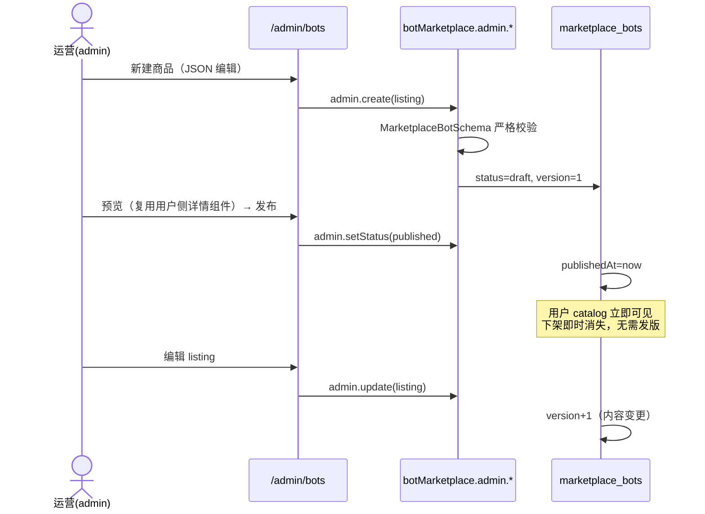
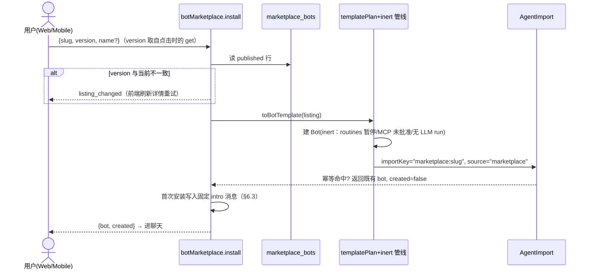
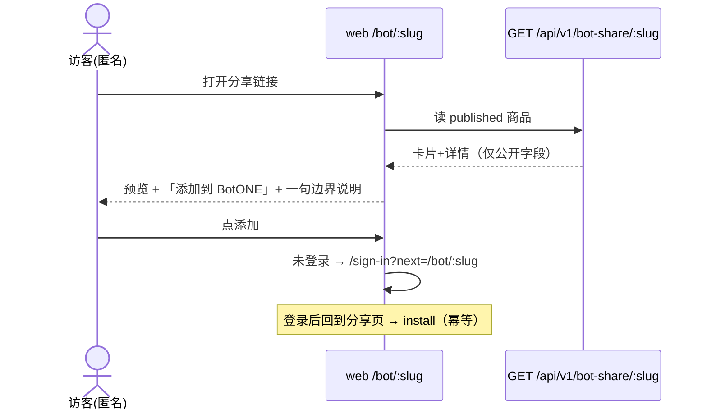

# Botone Bot 市场设计方案

日期：2026-11-12（v2）。前置输入：[bot-marketplace-survey.md](./bot-marketplace-survey.md)（仓库实测勘察）、[bot-marketplace-research.md](./bot-marketplace-research.md)（竞品调研）、[bot-marketplace-product-ui-review.md](./bot-marketplace-product-ui-review.md)（产品评审，含草图复审更新）、[bot-marketplace-sketch.html](./bot-marketplace-sketch.html)（交互草图，信息架构基线）。

**v2 相对 v1 的核心变化**：
1. 目录从「外部 GitHub 注册表聚合」改为 **Postgres 表 + 运营管理后台**——运营线上随时增删改、发布/下架，即时生效，不发版。外部注册表降级为远期可选项。
2. 对齐交互草图：新增**最小分享页**（匿名可看）、**固定文案 intro**（bot 先开口，不跑 LLM）、**聊天内例行任务/应用设置卡片**、**受控分类**。
3. DB 行即权威数据源，v1 为外部索引设计的 digest pinning、TTL 拉取纪律全部移除；安装校验沿用模板已验证的 version 乐观锁。

---

## 1. 目标与范围

**目标**：为 botone 建一个 Bot 市场——用户可浏览、预览、一键添加现成 Bot（人设 + 技能 + 例程 + 应用依赖）；**运营通过管理后台随时维护目录**；第三方可提交 Bot 上架、管理员审核（二期）。参考 Grok Bot 市场与 OpenMausBot Team Library，但所有对接点落在 botone 现有管线上。

**范围内**：DB 目录 + 运营后台、商品声明格式、安装流（复用模板管线 + 固定 intro + 聊天内设置卡）、最小分享页、版本规则、安全策略、分阶段实施。

**范围外（远期才考虑）**：评分/评论、支付分成、多 Bot 团队包、私有组织目录、外部注册表聚合、www 营销目录全集。勘察报告 §4 已确认 botone 无任何现存基础，全部标为新增。

---

## 2. 三市场对比

### 2.1 Grok Bot 市场（xAI）

> ⚠️ 假设标注：外网未直接访问。以下基于两类代码事实：(a) botone 已对接的 xAI **插件**注册表（`packages/adapters/src/plugin-marketplace.ts:8-27`：`github.com/xai-org/plugin-marketplace` 的 `.grok-plugin/marketplace.json` + `plugin-index.json`）；(b) 本机 OpenMausBot 源码中解析 x.ai 页面的代码（`dist-server/shared/grok-import.js`、`dist-server/server/team-library.js:400-425`）。据此推断的 Grok **Bot** 市场形态：托管在 x.ai，商品页含 name/creator/description（公开卡片仅此三项），加 Bot 按钮指向 `x.ai/bot/<shareId>`（21 位 share id），完整配置不通过公开 API 下发。

| 维度 | Grok Bot 市场 | OpenMausBot Team Library | botone 插件市场现状 |
|---|---|---|---|
| 托管 | x.ai 闭源托管 | GitHub 仓库（`milind-soni/openmausbot-teams`，catalog.json） | 聚合 Cursor + xAI GitHub 注册表（adapters 层） |
| 商品格式 | 闭源（公开卡片 name/creator/desc） | `openmaus.package` v1/v2 JSON + botmrr Markdown 单文件 | 无 Bot 商品；插件走 digest 校验预览 |
| 审核 | 平台方控制 | 仓库 PR 即审核 | PluginSubmission 邮件确认 + admin 审核 |
| 安装授权 | 平台 | 严格解析 + 字节上限（无 digest） | **digest（sha256）pinning，索引只做发现** |
| 安装后状态 | 未知 | skills off、routines paused（schema 强制 `enabledAfterInstall: literal false`） | inert（不发介绍、routines 暂停、MCP 未批准） |

### 2.2 OpenMausBot Team Library（本机实测源码，npm 全局包 `openmausbot@0.1.139`）

- **目录**：`dist-server/server/team-library.js` — `TEAM_LIBRARY_CATALOG_URL = raw.githubusercontent.com/milind-soni/openmausbot-teams/main/catalog.json`，格式 `openmaus.catalog` v1，≤100 个 team；条目字段：slug/name(≤100)/summary(≤300)/category/outcome/setupMinutes(1-240)/**featured**/package(.md)/manifest(.mausteam.json)/readme/members/skills(SKILL.md 路径)/requires.apps(≤30)。拉取带 10s 超时、content-length 与实际字节双重上限（目录 256KB、清单 1MB）、`redirect:"error"`，**严格解析后才进渲染层**。
- **商品格式**：`dist-server/shared/package-format.js` — `openmaus.package`：id(slug)/release(semver)/name/tagline(≤160)/summary(≤2000)/category/author{name,url}/license/featured/tags/outcomes(1-12)/setupMinutes/requirements{apps[{slug,label,reason,optional}],capabilities,platforms}/agents(1-200，含 soul+appearance+playbooks+skills)/chiefOfStaff/rooms(≤30)/routines(≤50，`enabledAfterInstall: z.literal(false)`)/playbooks(≤80)/skills/examples(≤12)。未知字段剥离——"ids, grants, credentials, paths, model selections and runtime state never cross the package boundary"（`server/bot-package.js` 头注释）。导出含密钥扫描与脱敏（`packageSecretFindings`/`redactPackageSecrets`）。
- **单文件 Markdown**：`renderBotPackageMarkdown` 生成 YAML frontmatter（`botmrr: 1`）+ 人类可读正文，"任何 Chief-of-Staff agent 不依赖 OpenMausBot 也能读懂"。
- **发现与安装 API**（`dist-server/server/routes/teams.js`）：`GET /api/team-library/catalog`（目录）、`GET /api/team-library/teams/:slug`（商品）、`POST /api/teams/import`（安装：additive-only、`trust:"file"` 不能声明发布者、技能默认关、例程暂停）、`POST /api/org-library/add`（组织私有包，`installId` 32-hex 幂等，`alreadyAdded` 返回 200）。Grok 导入（`POST /api/team-library/grok`）：公开卡片 + 用户在自己 Grok Bot 里粘贴导出提示词拿回完整配置。
- **本机运行数据**：`~/.openmausbot/bots.json` 两个 Bot（DshBot/MausBot），服务未在 8799 端口运行（勘察时 `lsof` 无监听）。

### 2.3 可借鉴点 vs botone 已有更好实现

| OpenMausBot 做法 | 结论 | 依据 |
|---|---|---|
| 目录 JSON 严格解析 + 字节上限 + 超时 + redirect 拒绝 | 仅远期接外部注册表时需要；MVP 目录在 DB，无拉取面 | `packages/adapters/src/plugin-marketplace.ts:8-50` |
| `enabledAfterInstall: z.literal(false)` 在 schema 层锁死"装完即暂停" | **已借鉴**：模板管线 routines 全部 `active:false`（`apps/api/src/bot-templates.ts:69`），市场继承 | package-format.js:217-228 |
| `alreadyAdded` 幂等安装 | botone **已有等价**：`AgentImport @@unique([spaceId,userId,importKey])`（schema.prisma:1647） | 两者等价 |
| botmrr Markdown 单文件商品（可脱离平台阅读/传播） | **二期**：从现有 Bot 导出为商品时对齐 | bot-package.js renderBotPackageMarkdown |
| 导出时密钥扫描 + 脱敏 | **二期**：botone 靠 schema 白名单防带入，扫描作防御纵深 | packageSecretFindings |
| outcomes/setupMinutes/featured/category 目录元数据 | **已借鉴**：进商品 listing 字段 | team-library.js:53-77 |
| examples（≤12 组输入/输出示例） | 暂不借鉴：MVP 沿用模板单个 `sample`(≤2000) + 草图「演示数据」标注 | bot-template.ts:27 |
| 组织私有包库（org-library） | **远期** | routes/teams.js:257-283 |
| 多 agent 团队包（agents/rooms/chiefOfStaff） | **远期**：botone 有 parentBotId 层级与群组，市场 MVP 单 Bot 商品 | package-format.js:216 |
| Grok 粘贴导出提示词导入 | 不借鉴 | grok-import.js |

---

## 3. 总体架构

```mermaid
flowchart LR
    subgraph 运营
        ADM["/admin/bots 运营后台<br/>(新, 复制 AdminPluginsPage 模式)"]
    end
    subgraph 客户端
        W["Web 市场页/详情<br/>(PluginsOverlay 内, 新)"]
        S["分享页 /bot/:slug<br/>(新, 匿名可看)"]
        M["Mobile (settings)/bot-market<br/>(新)"]
    end
    subgraph API[apps/api]
        NS["botMarketplace RPC 命名空间<br/>(新)"]
        PUB["GET /api/v1/bot-share/:slug<br/>(新, 公开只读, 限流)"]
        TP["templatePlan()+inert 安装<br/>(现有, bots.ts:343)"]
        CHAT["固定 intro + 设置卡片<br/>(新消息块 marketplace_setup)"]
    end
    subgraph Data[(Postgres)]
        MB[(marketplace_bots 新<br/>全局目录表)]
        AI[(AgentImport 现有)]
        B[(Bot 现有)]
    end
    ADM -->|requireAdmin| NS --> MB
    W --> NS
    M --> NS
    S --> PUB --> MB
    NS --> TP --> AI --> B
    TP --> CHAT
```

**关键决策 D1——平行 `botMarketplace` RPC 命名空间，不扩 `marketplace`**。理由：(a) 现有 `marketplace.catalog` 输出 `PluginMarketplaceCatalogSchema`、`submissions`/`review` 是插件审核专用（rpc.ts:1082-1090），塞进 Bot 会破坏现有消费者（web PluginsOverlay）并混淆权限矩阵；(b) botone 路由按"一个命名空间一个 routes 文件"组织（`apps/api/src/router.ts:158` 展开 ~20 个 route 模块），平行命名空间 = 独立文件、独立评审面，与仓库惯例一致；(c) 命名对称（`marketplace`/`botMarketplace`）保持 vendor 中立。

**关键决策 D2——商品 = BotTemplate 超集，安装 = 模板管线**。市场商品去市场元数据后就是合法 `BotTemplate`，`templatePlan()`（`apps/api/src/bot-templates.ts`）原样复用，享受 inert 语义与幂等。注意 `createBotFromTemplate` 现状硬编码内置目录（`findBotTemplate`）与 `template:` 前缀，不能直接喂 DB 商品：需把其请求构建核心提取为接受「模板对象 + importKey + source」的导出函数，原函数包一层内置目录查找（上游文件的小型局部重构，见 §10.1），市场与模板共用同一条技能复用/归档让位/事务写入逻辑，不复制。

**关键决策 D3——DB 是唯一权威目录，运营后台线上随时维护**。目录 = `marketplace_bots` 表中 `status="published"` 的行。运营在 `/admin/bots` 创建草稿、编辑、发布/下架、设精选与排序，**即时生效，不发版、不提 PR**。因此 v1 的外部注册表仓库、`rakazo.bot-catalog/1` 索引格式、adapters 聚合、digest pinning、TTL 拉取纪律全部移出 MVP（远期可选）；DB 行即权威，安装校验只需 version 乐观锁。

**关键决策 D4——安装后 = inert + 固定文案 intro**（产品已拍板，见评审更新）。不跑 LLM intro run：listing 携带运营撰写的 `intro`/`firstQuestion`，安装时作为确定性 bot 消息写入。routines 仍默认暂停，由聊天内卡片的用户显式动作开启；MCP/应用授权仍不自动批准。安全语义不变，首次使用体验按草图屏 4。

---

## 4. 数据模型

### 4.1 商品声明：`MarketplaceBotSchema`（新，contracts）

以 `BotTemplateSchema`（`packages/contracts/src/bot-template.ts:19`，strictObject）为超集原型：

```ts
// packages/contracts/src/bot-marketplace.ts（新文件）
export const MarketplaceBotSchema = BotTemplateSchema.extend({
  // —— 市场元数据 ——
  author: z.strictObject({ name: z.string().min(1).max(100), url: z.string().url().max(500).optional() }),
  license: z.string().min(1).max(80),
  category: z.enum(["personal", "engineering", "sales", "operations"]), // 受控分类，见下
  tagline: z.string().min(1).max(160),
  outcomes: z.array(z.string().min(1).max(240)).min(1).max(12),
  setupMinutes: z.number().int().min(1).max(240).optional(),
  homepage: z.string().url().max(500).optional(),
  tags: z.array(z.string().min(1).max(80)).max(30).default([]),
  versionNote: z.string().max(500).optional(),
  // —— 安装后首条消息（D4，固定文案，运营撰写）——
  intro: z.string().min(1).max(2000).optional(),        // 缺省则安装后静默（回退 inert）
  firstQuestion: z.string().min(1).max(500).optional(), // 拼在 intro 之后
});
// 保持 BotTemplate 全部既有约束：skills≤5、routines≤5(crons 1-5)、apps≤6、
// summary≤120、sample≤2000 —— 且**刻意不含**密钥/模型/记忆/历史/服务器
//（bot-template.ts:14-18 的安全边界原样继承）。
```

- **受控分类**：草图固定 4 类（个人/工程/销售/运营），每 bot 单一主分类。MVP 用契约枚举，显示名走 i18n；扩分类 = 契约变更 + 发版。分类是信息架构，低频变化；若运营后续需要动态分类，二期加分类表，不在 MVP 预留。
- **slug 即 `listing.id`**：沿用 BotTemplateSchema 的 slug 规则（`^[a-z0-9]+(?:-[a-z0-9]+)*$`，≤64）；`marketplace_bots.slug` 列取自 `listing.id`，**创建后不可变**（importKey `marketplace:<slug>` 的稳定性依赖它），`admin.update` 拒绝改 id。
- **与 BotTemplateSchema 映射**：`toBotTemplate(m: MarketplaceBot): BotTemplate` = 字段直取（id/version/name/summary/sample/description/instructions/skills/routines/apps）。市场元数据与 intro 字段留在安装流程层，不进模板管线。
- **配套契约小改**（上游文件，见 §10.1）：`AgentImportSourceSchema`（agent-import.ts:49）加 `"marketplace"`；agent-import.ts:238 的 importKey 前缀预留校验加 `marketplace:`（agent import 不得占用）；新文件导出 `BOT_MARKETPLACE_IMPORT_KEY_PREFIX = "marketplace:"`。

### 4.2 目录表：`marketplace_bots`（新，1 张）

```prisma
/// 市场目录。全局表，RLS 照 plugin_submissions 先例（见 §7.6）。
model MarketplaceBot {
  id          String    @id @default(cuid())
  slug        String    @unique
  version     Int       @default(1)        // listing 内容任何变化自动 +1
  status      String    @default("draft")  // draft | published | unpublished
  featured    Boolean   @default(false)
  sortOrder   Int       @default(0)
  listing     Json                         // MarketplaceBotSchema 解析后的完整商品
  publishedAt DateTime?
  createdBy   String?                      // admin userId，轻量审计
  updatedBy   String?
  createdAt   DateTime  @default(now())
  updatedAt   DateTime  @updatedAt
  @@index([status, sortOrder])
  @@map("marketplace_bots")
}
```

- 目录读 = `status="published"` 行，服务端过滤；草稿/下架对普通用户完全不可见。
- `AgentImport.source` 是普通 String（schema.prisma:1640），加 `"marketplace"` 值**不需要 enum 迁移**；importKey 前缀 `marketplace:`（与 `template:` 同规则：预留前缀、幂等键、重试返回同一 Bot）。
- **安装计数 MVP 不建表**：`AgentImport(source:"marketplace")` 已记录每次安装，二期需要展示时再决定是否加 `MarketplaceBotInstall` 聚合表。
- 迁移纯新增表，符合 AGENTS.md 部署纪律（旧 release 不读新表）。

### 4.3 提审表：`BotSubmission`（二期）

复制 `PluginSubmission`（schema.prisma:543）模式：邮件确认 + admin 审核 + 限流。**与 v1 的关键差异：审核通过 = 写入 `marketplace_bots`（upsert 同 slug），目录保持单一来源**，不再搞「注册表条目 + approved 行并行合并」。

```prisma
model BotSubmission {
  id               String    @id @default(uuid())
  email            String
  slug             String    @unique
  confirmToken     String?
  confirmExpiresAt DateTime?
  listing          Json      // MarketplaceBotSchema 解析后的完整商品
  status           String    @default("pending")  // pending|approved|rejected
  reason           String?   // 驳回理由
  reviewedAt       DateTime?
  createdAt        DateTime  @default(now())
}
```

---

## 5. RPC / API 设计

### 5.1 `botMarketplace` 命名空间（挂入 `AppContract`，新 routes 文件注册进 router.ts）

| 方法 | 输入 → 输出 | 权限 |
|---|---|---|
| `catalog` | `{query≤200, category?}` → `{entries[]}`（卡片元数据：slug/name/tagline/category/featured/sortOrder/author/apps 摘要 + **botId: nullable**） | `signedIn` |
| `get` | `{slug}` → `{listing, botId: nullable}` | `signedIn` |
| `install` | `{slug, version, name?}` → `{bot: BotSchema, created: boolean}` | `signedIn` |
| `admin.list` | `{status?}` → 全部行（含草稿） | `requireAdmin` |
| `admin.create` | `{listing}` → 草稿行（slug = listing.id） | `requireAdmin` |
| `admin.update` | `{slug, listing?, featured?, sortOrder?}` → listing 内容变更自动 bump version；仅元数据变更不 bump；拒绝改 id | `requireAdmin` |
| `admin.setStatus` | `{slug, status: "published"\|"unpublished"}` → 即时生效 | `requireAdmin` |

- **catalog 规则**：只返回 published 行，按 `sortOrder` 排序（精选 band 由前端按 `featured` 过滤，草图屏 1）；`query` 匹配 name/tagline/summary（与草图搜索范围一致）；`botId` 由 `AgentImport(importKey:"marketplace:<slug>", 当前 space/user, bot 未归档)` 查得——逐行复制 `listBotTemplates` 的 join 模式（bot-templates.ts:34-53），行内「添加/已添加」状态由此而来。
- **未发布即不存在**：`get`/`install` 对非 published 的 slug 统一 `not_found`，与公开路由一致，不泄露草稿存在性。
- **没有 preview RPC**：草图「添加」直接创建，无确认弹窗；详情页 `get` 已含全部可见信息（「查看配置」折叠展示 instructions/skills）。v1 的 preview 步骤移除。
- **没有硬删除**：下架即覆盖需求；已装 Bot 是独立快照，不受目录变化影响。
- 安装内部流：`install` → 读 published 行 → `toBotTemplate()` → 提取后的模板创建核心（version 乐观校验 + `templatePlan()` + inert 事务）→ intro 随 `request.cards` 写入（§6.3）→ `AgentImport(importKey:"marketplace:<slug>", source:"marketplace")` → 返回 `{bot, created}`。

### 5.2 公开分享只读路由（新，非 RPC）

`GET /api/v1/bot-share/:slug`（对齐 `PLUGIN_SUBMISSIONS_PATH` 公开 HTTP 模式，domain.ts:982）：
- 实现照 `pluginSubmissionRoutes`（plugin-submissions.ts:131）：独立 Hono 子应用挂进 index.ts，限流用现成 `windowCounter` + `throttleKey(clientIp)`；
- 匿名可访问，**仅返回 published 行**的公开字段（卡片 + 详情展示所需，不含任何用户数据）；
- 限流（60 次/IP/分钟量级，实现时定常量）；不存在/未发布统一 404，不泄露草稿存在性。

### 5.3 错误码

| 错误 | 场景 | 依据 |
|---|---|---|
| `listing_changed` | install 携带的 version 与当前行 version **不一致**（模板语义是 `!==` 即拒，bot-templates.ts:161，不是只拒旧版） | 复制 `BOT_TEMPLATE_CHANGED`（bot-template.ts:81）模式 |
| `not_found` / `forbidden` | slug 不存在 / 非 admin 调 admin.* | ORPCError 常规码（admins.ts requireAdmin 抛 FORBIDDEN） |
| `already_installed` | 幂等命中，返回既有 bot + `created:false`（不报错） | 对齐 CreateBotFromTemplateOutput.created 语义 |

### 5.4 权限矩阵

| 操作 | 匿名 | signedIn | admin |
|---|---|---|---|
| 分享页只读（公开路由） | ✓（限流，仅 published） | ✓ | ✓ |
| catalog/get/install | ✗ | ✓ | ✓ |
| admin.* | ✗ | ✗ | ✓（`RAKAZO_ADMIN_EMAILS` + 邮箱已验证，admins.ts） |
| submit（二期） | HTTP 限流 ✓（邮件确认前不算入队） | ✓ | ✓ |

---

## 6. 全流程时序

### 6.1 运营发布（MVP 核心）



### 6.2 安装



### 6.3 安装后的聊天（草图屏 4，D4）

1. **bot 先开口**：install 首次创建时，把 `listing.intro`（+ `firstQuestion`）作为一条确定性 bot 消息写入会话——运营撰写、随商品审核，**不跑 LLM、零 token 成本、双端一致**。intro 缺省则静默（回退现状 inert）。边界由 bot 亲口说（「没有你的确认，我不会发送或改动任何东西」）。
   **写入机制（已核实）**：`writeImportedBot` 本就在安装事务内把 `request.cards` 作为 bot 消息写入（agent-import.ts:621-628，先于清单卡），intro 用现成 `text` 块（events.ts:125）拼进 cards 即可，无需新写入路径；幂等命中在 `already()` 提前返回（agent-import.ts:361-362），不会重复写 intro。
2. **例行任务卡片**：intro 之后跟一条 `marketplace_setup` 消息块（新 kind，渲染模式复制 `import_setup` 卡，`apps/web/src/pages/shell/import-setup-card.tsx`）：人类可读频率 + 时区（「工作日 8:00 早报，暂停中」），按钮「现在开启 / 稍后」。
   - 「现在开启」→ 现有 routines 更新 RPC（`active:true`，用户显式动作）→ 成功显示系统行「例行任务已开启 · 工作日 8:00」；**失败保留卡片可重试**，不静默吞掉。
   - 「稍后」→ 系统行提示「之后可以在 Bot 设置里开启」；Bot 的 Routine 设置是长期入口，不依赖这张历史卡片。
   - **管线改动**：`writeImportedBot` 现状对含 routines 的安装自动写 `import_setup` 清单（agent-import.ts:629-637）。给 `ImportedBotRequest` 加可选 `checklist?: MessageBlock[]` 覆盖默认清单（上游小改动，§10.1），市场安装传 `marketplace_setup` 块。**PR1 先沿用默认清单**（install 尚未对用户暴露），PR2 切换。
3. **应用多选卡**：商品声明的 apps 列表，可多选、有选中态，选了才能「完成」，也可「稍后」。「完成」→ 走现有应用连接/授权流（不自动授权）；无需应用的商品不出此卡。授权取消/失败/部分完成的状态承接见评审更新 §仍需补。现状 `templateAppCards` 逐应用出 `app_connect` 卡，多选卡是其市场版替代（PR2）。
4. **输入框常在**：所有问题都可以直接打字回答，不必只点按钮。
5. 与现有管线的关系：`import_setup` 清单卡继续服务 agent import 与模板，**不改其语义**；市场安装走新的 `marketplace_setup` 块。移动端按 native-first 适配（AGENTS.md），卡片语义双端一致；旧版客户端遇到未知块须优雅降级（§11）。

### 6.4 分享链接（草图屏 3）



- 分享页是 web 路由 `/bot/:slug`（App.tsx），**不是** www 营销目录；MVP 只做单商品预览 + 一个主按钮 + 边界文案（「Rakazo 官方创建并审核。添加后是你账户里的独立副本。」），静态 meta/OG 标签从简。条款链接留到开放第三方投稿后再加。
- 应用内没有这一步：市场页点「添加」直接创建进聊天（草图屏 1/2 → 屏 4）。

### 6.5 提审与审核（二期）

提交者 `POST /api/v1/bot-submissions`（listing + email）→ 解析校验 + 限流(10/IP/h) + 确认邮件(24h token) → `BotSubmission(pending)` → admin `botMarketplace.submissions/review` → approve **upsert 进 `marketplace_bots`**（同 slug 覆盖 listing、bump version、status=published）；reject 带理由。目录始终单一来源。

---

## 7. 安全与合规策略

1. **DB 权威 + version 乐观锁**：目录行是唯一安装依据；install 携带预览时 version，落后即 `listing_changed`。v1 的 digest pinning 随外部注册表一起移出 MVP——DB 行不存在「索引与文档分离」的信任缺口。
2. **inert + 固定 intro**：安装产物仍是惰性 Bot（routines 暂停、MCP/应用未批准、无 LLM run）；intro 是运营撰写的固定文案，随商品一起被 schema 校验与 admin 审核，不引入生成内容风险。例行任务开启必须是用户在卡片上的显式动作。
3. **schema 白名单 + 无密钥边界**：`MarketplaceBotSchema` 保持 strictObject；继承 bot-template.ts:14-18 硬边界——无密钥/模型/记忆/历史/服务器字段。二期提审/保存时附加密钥模式扫描（借鉴 OMB `packageSecretFindings`，防御纵深）。
4. **vendor 中立**（AGENTS.md 纪律）：contracts/core/UI 只见中立格式与分类枚举；vendor 名仅可能出现在远期 adapters 注册表层。
5. **限流与反滥用**：公开分享只读限流；二期提审复制 plugin-submissions 常量（10 次/IP/小时、3 次确认/邮箱/天）。
6. **租户隔离与全局表**：`marketplace_bots` 照 `plugin_submissions` 先例——全局目录表，不开租户 RLS；公开读在服务端过滤 published，写只走 `requireAdmin` RPC。安装仍过 `signedIn`（actor + `asTenant`，routes/context.ts:416-431），AgentImport/Bot 照常受 RLS 约束。
7. **运营权限与审计**：admin RPC 全部 `requireAdmin`；`/admin/bots` 路由 `me.isAdmin` 门禁（复制 AdminPluginsPage）；createdBy/updatedBy/publishedAt 轻量审计起步，完整审计后续接现有 audit-events。
8. **匿名暴露面**：公开路由只返回 published 商品的公开展示字段；不存在与未发布统一 404。

---

## 8. 版本与更新机制

- **版本递增**：`version` 正整数，listing 内容任何变化由 `admin.update` 自动 +1；仅 featured/sortOrder 等元数据变更不 bump。
- **幂等语义（已拍板）**：每用户每空间每 slug 一个 Bot；已装时市场页/详情按钮为「已添加 / 打开我的 Bot」，返回旧 Bot，不重复创建。**不选空间**——安装到当前 actor 空间（与模板一致）。
- **已装 Bot 不自动更新**：安装产生的是用户自己的 Bot（快照，instructionHistory 归用户）；运营改 listing 只影响之后的安装。**MVP 不做「有新版」提示与升级入口**（草图无此 UI，评审范围修正一致）；二期再加详情页提示 + 「装为新副本」（新 importKey `marketplace:<slug>@<version>`）。

---

## 9. 分阶段实施计划

| 阶段 | 交付物 | 验收标准 | 粗估 |
|---|---|---|---|
| **PR1 后端 + 运营后台** | ① contracts：`bot-marketplace.ts`（MarketplaceBotSchema + intro 字段 + 分类枚举 + 错误码）+ §10.1 契约小改 ② `marketplace_bots` 表 + 迁移 ③ `routes/bot-marketplace.ts`：catalog/get/install + admin.*（含 bot-templates.ts 提取重构）④ **详情展示组件**（`components/bot-marketplace/`，接 listing prop，PR2 用户页复用）⑤ web `/admin/bots`：列表（状态筛选）+ JSON 编辑 + schema 校验内联报错 + 预览（用④）+ 发布/下架/精选/排序 ⑥ 可选：内置模板（packages/core）一键导入为草稿——内置模板无市场元数据，导入时填默认值（author=官方、tagline=summary、outcomes 占位），**分类由运营选定、元数据补齐后才可发布**，冷启动不空目录 | 建草稿→预览→发布→catalog 立即可见；下架即时消失；内容变更 version 自动 +1；非 admin 全 FORBIDDEN；schema 拒绝密钥/模型字段；全部新 RPC 有契约测试 | 1.5-2 周 |
| **PR2 用户侧 + 分享页** | ① web 市场页/详情（PluginsOverlay 入口，草图屏 1/2：分类 chips + 搜索 + 精选 band + 分类行 + 空状态；详情 facts/折叠配置/示例标注/固定 CTA）② `marketplace_setup` 消息块：固定 intro + 例程卡 + 应用多选卡（web）③ mobile `(settings)/bot-market` 列表/详情 + 聊天卡片 native 适配 ④ 分享页 `/bot/:slug` + 公开只读路由 + 登录跳转 | 添加产生 inert Bot + 固定 intro；重复安装 created:false；version 不符拒绝；例程开启成功/失败/稍后三态正确；分享页匿名可看、未发布 404；双端信息顺序与规则一致 | 2-3 周 |
| **二期** | ① BotSubmission 提审 + 邮件确认 + admin 审核 → upsert 入库 ② 安装计数展示 ③「有新版」提示 + 装为新副本 ④ 从现有 Bot 导出为商品（对齐 botmrr Markdown+YAML）⑤ 保存/提审密钥扫描 | 提审→确认→审核→上架全链路；驳回理由可见；导出商品不含密钥/用户数据 | 2 周 |
| **远期** | 外部注册表聚合（adapters 层，含 xAI Grok bot 注册表若开放）、评分/评论/截图、多 Bot 团队包、组织私有目录、支付分成、www 营销目录 | 按单项另立设计 | 不估 |

---

## 10. 复用 vs 新增清单

### 10.1 上游文件的最小改动（AGENTS.md 纪律，全部局部、可独立评审）

| 文件 | 改动 |
|---|---|
| apps/api/src/bot-templates.ts | 把 `createBotFromTemplate` 的请求构建核心提取为导出函数（接受模板对象 + importKey + source + changedReason），原函数包一层 `findBotTemplate`；行为不变 |
| apps/api/src/agent-import.ts | `ImportedBotRequest` 加可选 `checklist?: MessageBlock[]`，缺省仍写 `import_setup`（PR2 才用） |
| packages/contracts/src/agent-import.ts | `AgentImportSourceSchema` 加 `"marketplace"`；importKey 前缀预留校验加 `marketplace:` |
| packages/core/src/agent-import/index.ts | 文件导入来源的 `Exclude<AgentImportSource, …>` 同步排除 `"marketplace"`（市场商品不是文件导入，两处类型收窄） |
| packages/contracts/src/rpc.ts | 挂 `botMarketplace` 命名空间 |
| apps/api/src/router.ts | 注册新 routes 模块 |
| apps/web/src/App.tsx | `/admin/bots` 路由（照 `/admin/plugins`） |
| packages/db/prisma/schema.prisma | 增 `MarketplaceBot` 模型 |

### 复用（零改动）

| 现有资产 | 位置 | 用法 |
|---|---|---|
| `BotTemplateSchema` 安全边界 | packages/contracts/src/bot-template.ts:19 | 商品超集原型 |
| `templatePlan()` + inert 安装 | apps/api/src/bot-templates.ts; routes/bots.ts:343 | 经 §10.1 提取后调用 |
| `AgentImport` 幂等 | schema.prisma:1647 | importKey `marketplace:` 前缀；source 为普通 String，无需 enum 迁移 |
| `isAdmin`/`requireAdmin` | apps/api/src/admins.ts | 运营权限原样用 |
| AdminPluginsPage 门禁 + 路由模式 | apps/web/src/pages/AdminPluginsPage.tsx; App.tsx:252 | `/admin/bots` 照抄 |
| `plugin_submissions` 全局表先例 | migrations/20261104120000 | 目录表 RLS 策略 |
| `import_setup` 卡片渲染模式 | apps/web/src/pages/shell/import-setup-card.tsx | `marketplace_setup` 块的渲染参照（不改原块） |
| routines 更新 / 应用连接授权流 | 现有 RPC | 卡片按钮的落点 |
| `signedIn`/`asTenant` | apps/api/src/routes/context.ts:416-431 | 所有用户侧 RPC |
| PluginSubmission 审核 + 限流 + 邮件确认 | apps/api/src/plugin-submissions.ts | 二期复制为 bot 版 |
| web/mobile 市场容器与导航 | PluginsOverlay.tsx（Templates 按钮旁）; apps/mobile/app/(settings)/ | 新页挂进现有入口 |

### 新增（建议落点）

| 模块 | 文件 |
|---|---|
| 商品/错误码契约 | `packages/contracts/src/bot-marketplace.ts`（rpc.ts 挂 `botMarketplace`） |
| RPC routes | `apps/api/src/routes/bot-marketplace.ts`（router.ts 注册） |
| 公开分享只读 | `apps/api/src/bot-share.ts` + `GET /api/v1/bot-share/:slug` |
| Prisma 表 | schema.prisma 增 `MarketplaceBot`（二期增 `BotSubmission`） |
| 运营后台 | `apps/web/src/pages/AdminBotsPage.tsx` + `/admin/bots` 路由 |
| Web 用户侧 | `apps/web/src/pages/bot-marketplace/{browse,detail}.tsx` + PluginsOverlay 入口 |
| 分享页 | `apps/web/src/pages/BotSharePage.tsx` + `/bot/:slug` 路由 |
| 聊天设置卡 | `marketplace_setup` 消息块（contracts + web 渲染 + mobile 渲染） |
| Mobile 用户侧 | `apps/mobile/app/(settings)/bot-market/{index,detail}.tsx` |

### v1 移除项（远期再议）

adapters 注册表聚合、`rakazo.bot-catalog/1` 索引格式、官方注册表仓库、digest pinning、TTL/字节上限拉取纪律、catalog 并行合并逻辑。

---

## 11. 已知不确定项与假设

1. **intro 消息写入**：已核实走 `request.cards`（安装事务内，§6.3），无悬念；幂等命中（created:false）不重复写。
2. **移动端聊天卡片形态**：native-first（AGENTS.md），`marketplace_setup` 在 iOS 用原生卡片/按钮承载，语义与 web 一致；草图是 web IA 基线，不是移动端视觉稿。**旧版客户端兼容**：新消息块 kind 上线前核实双端 transcript 渲染对未知块的降级行为（应显示占位而非崩溃），PR2 验收项。
3. **分享页 SEO/OG**：MVP 静态 meta 从简；完整 www 营销目录属远期。
4. **分类扩展**：契约枚举，扩分类需发版；运营需要动态分类时二期加表。
5. **xAI Grok bot 注册表是否存在**未知——远期若开放，在 adapters 层加注册表记录，届时才需要 v1 的拉取纪律与 digest 门禁。
6. **邮件基础设施**（二期）沿用 plugin-submissions 既有通道。
7. OpenMausBot 结论来自其 npm 包源码静态阅读，未做运行时验证（勘察时 8799 无监听）。