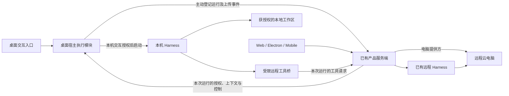

# Botone 本机与远程 Harness 接入方案

更新日期：2026-11-13。代码基线：已合并上游的 `main`，提交 `39741cb9b`。

Botone 的账号、聊天、配置、运行记录和工具服务统一部署在服务端，桌面端连接该实例。本次补齐桌面客户端调用本机已安装、已登录的代理引擎，先完成本地工作区，再接远程云电脑；保留已有远程 harness 路径。Mac 与 Windows 是本机接入的目标平台，原生能力要求及实机验收范围见下文；客户端只承载宿主执行模块，不要求运行本地 API、worker、数据库、Docker 或 Linux VM，不新增独立部署的执行 daemon。

本文替代旧方案的云端优先实施顺序、独立执行服务部署、以本地产品栈为前置条件的设计和已过时的代码接入清单。远程执行的既有重构记录见[原生执行精简方案](native-harness-simplification-plan.zh-CN.md)。以下区分已有代码、拟新增能力和待验收项目；已有驱动不等于所有平台都已通过真实模型验证。

实施分支：`codex/desktop-local-harness`。当前已接通首个本机引擎的产品闭环：

- 桌面连接现有服务器，在 Bot 的 Agent 设置中选择本机账号；原生目录选择和授权绑定当前服务器、用户、空间与 Bot。
- 本机工作区和远程电脑两种目标共用执行、事件、审批和生命周期协议。远程模式提供命令、文本文件读写、目录与文件附件工具；命令、写入和附件发布须逐次审批。
- 登录留在本机，执行授权不进入渲染进程。执行前检查有效配置，关闭用户及项目的 MCP、hooks、插件等旁路；原生配置不能满足约束时不提交 prompt。空 TOML 表会合并已有配置，因此按实际服务器名称显式禁用 MCP。
- 服务端记录运行与延后的持久兜底，桌面即时执行。事件按序确认、幂等续传；断线、登录退出、切换服务器或 App 退出会停止本机任务，恢复日志不会重发 prompt，也不会改用服务端模型。
- 首个适配器仅接纳已核对的 Codex CLI `0.167.0`。在 Linux 上通过真实 CLI 配置及权限检查，并显式运行本地写文件、远程动态工具与审批两个模型冒烟回合。远程冒烟使用隔离的工具测试端，服务端授权另由 Postgres 集成测试覆盖，未据此声称真实云提供方已验收。
- 模型冒烟与默认离线测试分开运行。引擎返回了 token 用量，但未返回金额，费用记录为未知；离线协议、桌面生命周期、Postgres 及浏览器测试不调用模型。
- 宿主进程清理在 Linux 使用独立 subreaper 收养后代，以 pidfd 定向终止并由 `waitpid` 确认全部后代退出；不再把进程组视作完整进程树。需要系统 `/usr/bin/python3`、Python 的 `pidfd_open` / `pidfd_send_signal`、内核对应能力及可读的 `/proc`；发现阶段先探测，缺失时显示不支持。Windows 继续使用现有 Job Object，未改变其启动和清理路径。
- macOS 15 及以上的本机 harness 使用每次运行的原生权限配置，为工具沙箱加入唯一的可读/不可读探针文件。文件位于 `/private/tmp` 下当前用户专用的受保护目录，不修改工作区；所有运行都禁止工具改动整个探针目录，各自只允许读取自己的正向探针，避免并行运行相互破坏。目录及文件的原始句柄由独立监护进程持有，每次识别及发信号前核对对象身份；探针丢失或被替换时拒绝推断进程归属、拒绝确认清理完成。工作区不能直接选择探针目录或其子目录。后台工具继承内核沙箱标记，监护进程在 `setsid`、双重派生、清空环境或 CLI 退出后仍可识别它们。原生 CLI 和其辅助进程另以原始父进程唯一身份追踪；信号通过审计令牌原子核对进程版本，避免 PID 复用误杀。运行中的 CLI 不使用外套沙箱，避免破坏其工具沙箱；不允许越出沙箱的审批重试，工作区正常读写和远程工具审批保留。监护进程在宿主控制管道关闭时清理，确认后删除本次探针，确认前不报告成功。发现阶段实际探测所需原生接口与沙箱标记，旧系统或能力缺失时显示不支持。复用已有 FFI 依赖，无需编译器、Python、常驻服务或特权。此方案面向受支持 CLI 的工具生命周期，不承诺约束主动更换沙箱策略的任意同用户恶意进程。依据：[Apple XNU 原子信号实现](https://github.com/apple-oss-distributions/xnu/blob/xnu-11215.1.10/bsd/kern/proc_info.c)、[固定版本原生沙箱继承与信号规则](https://github.com/openai/codex/blob/rust-v0.167.0/codex-rs/sandboxing/src/seatbelt_base_policy.sbpl)。
- 发现、桌面编排及进程清理测试接入现有 Mac 和 Windows CI；Mac CI 另安装固定版本的真实 CLI，在假账号目录和回环模型地址下离线检查工作区权限、工具沙箱标记及远程模式的严格权限配置和动态工具注册，不调用模型。本机开发检查在 Linux 上运行，跨平台结果以对应系统的实际测试为准，不能将 CI 配置视为已验收。两平台的签名安装包、真实账号模型流程，以及 Windows 的真实 CLI 沙箱仍需实机验收。

### 使用入口与首版边界

1. 在具备上述原生能力的 macOS 15 及以上、Windows 或 Linux 安装并登录兼容的原生 CLI，再连接已有产品服务器；客户端无需 API、worker、数据库或 Docker。平台实机验收进度见上文；既有远程 harness 和宿主电脑功能不受本机 harness 的能力要求影响。Windows 使用原生可执行文件，支持官方 npm 安装中的原生包，不执行任意 `.cmd` 或自动切换 WSL。
2. 打开个人 Bot 的 Agent 设置，选择本机账号。选择 Local workspace 后使用系统目录选择器，并在原生窗口确认服务器与目录。默认模型沿用本机 CLI 的设置。
3. 要操作服务器电脑，将 Work on 改为 Computer，使用该 Bot 已配置的电脑。模型的本机命令工具被关闭，本机文件系统只读；项目命令、文件和附件均经服务端重新授权并委托既有电脑提供方。
4. 直接发送文本即可运行。运行记录进入原有聊天；审批只能由启动任务的桌面会话提交。网页和手机可以查看记录或停止运行，不能批准本机权限或继续本机任务。
5. 首版的本机消息入口只接收文本；带附件、引用、提及或混合例程的发送会保留草稿并报错。群聊和例程仍使用原有服务端路径。图形电脑操作、本地附件发布、其他本机引擎和自动安装 CLI 不在这次首版中。

已确认的部分文本在取消后仍保留。导航、停止、改配置和退出会立即撤销仍在等待账号、检查或服务端授权的启动请求；晚到授权只记录取消，不派发 prompt。正常退出先确认进程清理，再在最多五秒内上传取消及未确认输出；同步失败保留日志供之后认证核对。清理失败仍阻止退出，并允许再次 Stop / Quit。断线或崩溃后只核对和上传未确认事件，不重新启动代理；失效的会话、账户、工作目标或对话清空不会继续复用旧原生上下文。未确认的远程副作用不会自动重试。

## 1 交付范围

| 执行路径 | 当前状态 | 本次处理 |
| --- | --- | --- |
| 本机 harness → 本地工作区 | 已接通首个引擎的桌面入口、授权、事件与会话；实机验收范围见上文 | 第一条交付路径 |
| 本机 harness → 远程云电脑 | 已接通命令、文件与附件工具桥；本机原生工具保持受限 | 第二条交付路径，与本地工作区同属本次范围 |
| 远程 harness → 远程云电脑 | 已有通过电脑 Supervisor 执行的路径 | 保留并回归，不重建 |
| Mac 本地 Linux VM 内运行 harness | 新 `local-vm` 提供方尚未接入原生执行能力 | 后续单独适配，不作为本机接入前置条件 |

本机任务由桌面客户端交互发起，在本机后台执行模块中管理。手机、网页和定时任务沿用其已有远程执行路径及能力限制，不增加“调用家中电脑”的入口。本机退出或掉线后不自动切换远程引擎、账号或工作区。

客户端主动向服务端登记运行、接收本次运行的授权与上下文、上传事件和结果。服务端可以拒绝、撤销或结束已登记的运行，但不能主动创建本机执行。这里需要运行同步，不建设远程设备任务调度、后台唤醒、退出 App 后继续运行的常驻服务、跨引擎原生历史迁移或自动安装升级 CLI。已有电脑访问功能不因本方案被删除，也不自动获得启动本机 harness 的权限。

## 2 合并后可以复用什么

### 服务端部署与 Mac 无 Docker 功能的关系

符合条件的 Apple Silicon、macOS 26 及以上桌面发行包可以选择原生本地栈；还需发行包提供服务器 bundle，并遵循既有安装迁移选择。API、worker、web 作为本机进程运行，数据库和隔离 Bot 电脑通过 Apple 容器运行时运行在 Linux VM 中。其他平台和未提供 bundle 的构建保留现有 Docker 路径。

这解决自托管用户在 Mac 上运行整套产品的问题。Botone 当前使用统一服务端部署，因此它是保留的可选上游能力，不是本次接入的底座，不需要调用 `NativeStackController` 启动本地产品服务。客户端运行 harness 也不要求 Apple 容器运行时或服务器 bundle；macOS 26 门槛属于该无 Docker 功能，不能直接套用到 harness 接入。

依据：[Mac 本地运行说明](desktop-mac-without-docker.md)、[本地栈](../apps/desktop/src/native-stack.ts)、[平台与发行包选择](../apps/desktop/src/main.ts)、[VM 提供方](../packages/adapters/src/apple-container-sandbox.ts)。上游文档中的真实验证范围不扩大为本机 harness 的验收结论。

### Windows 与平台范围

本机 harness 接入面向 Mac 和 Windows，两者均连接同一个服务端产品实例。桌面应用、目标 CLI 及其沙箱的系统要求分别检查，与本地产品栈要求分开。

截至 2026-11-13，上游 Windows 本机电脑访问已经实现，当前基线包含以下能力，不需要重新建设：

- 桌面授权后的宿主命令及文件访问，见[桌面使用说明](desktop-app.md#let-bots-use-this-computer)。
- Windows 应用观察与操作：[上游 #3015](https://github.com/elie222/rakazo/pull/3015) 已合并，复用现有屏幕接口和按需下载的驱动。支持受限的应用级操作，不代表任意坐标、键盘和管理员应用都可操作。
- 本地 `This computer` 模式的应用操作：[上游 #4177](https://github.com/elie222/rakazo/pull/4177) 已合并，并进入 [v0.10.0](https://github.com/elie222/rakazo/releases/tag/v0.10.0)。沿用所有者主动聊天和逐应用审批限制。

Windows 部署简化有开放提案 [#3149](https://github.com/elie222/rakazo/issues/3149)：在 WSL2 内安装 Docker Engine 与 Compose，减少对 Docker Desktop 的依赖。查询时尚无指派、讨论或搜索可见的对应实现 PR，没有可据以安排依赖的交付日期；这也不是完全无 Docker 的方案。[v0.11.0](https://github.com/elie222/rakazo/releases/tag/v0.11.0) 的 Windows 本地产品部署仍使用 Docker。这些都是自托管部署选项，不影响本次连接服务端的桌面接入。

因此实施顺序为：先验收桌面连接服务端时的现有 Windows 本机访问，再复用其宿主能力和信任边界，补齐 harness 的发现、登录状态、双向协议、审批和生命周期。已有屏幕驱动的 Windows CI 验证不替代本方案的实机验收；屏幕工具也不是文本及文件任务的必需依赖。

| 平台 | 产品服务位置 | 本机 harness 计划 |
| --- | --- | --- |
| Apple Silicon Mac，macOS 15 及以上且通过原生能力探测 | 现有服务端 | 本地工作区与远程工具两路径；实机验收进度见上文，不依赖 macOS 26 本地栈 |
| Windows x64，满足桌面应用及目标 CLI 的系统要求 | 现有服务端 | 本次验收 Windows 原生 CLI，客户端无需 Docker |
| Intel Mac，macOS 15 及以上且通过原生能力探测 | 现有服务端 | 同一原生实现；按实际架构和 CLI 另行验收；15 以下缺少所需原子信号接口 |
| Windows ARM64、Linux 桌面、WSL 中的 CLI | 现有服务端 | ARM64 安装发现有离线覆盖，Linux 有真实 CLI 冒烟；桌面发行包分别验收，不自动接入 WSL |

具备后代进程所有权的桌面后台在宿主启动 CLI，通过主动建立的受保护连接与产品服务端同步本次运行。CLI 登录留在宿主，服务端数据库和电脑提供方凭据留在服务端；不将宿主本地栈的访问 token 暴露给远程服务，也不让服务端通过通用命令执行接口启动 CLI。

Windows 原生与 WSL 是不同执行环境：可执行文件、登录、工作目录和进程归属分别绑定。首期不自动扫描或切换 WSL 发行版，不把 Windows 路径隐式转换成 Linux 路径，也不在原生启动失败后自动转用 WSL。Docker Desktop 使用 WSL 后端不等于产品已支持 WSL harness。

Windows 的平台适配要求：

- 发现 `.exe`、受支持的 Node CLI 入口及安装 shim；不能将任意 `.cmd`、`.bat` 内容当作可信脚本解析，也不通过 `shell: true` 拼接 prompt。必要包装器按已验证的安装形式适配；未知形式明确报不支持。覆盖空格、中文路径和 PATH 更新。
- 驱动仍使用 stdio；权限代理优先复用私有管道，Windows 端采用受当前用户访问控制保护的命名管道等本机传输，不公开监听端口。
- 复用现有 [Windows 进程树管理](../packages/adapters/src/desktop-process-tree.ts) 的 Job Object 与关闭清理机制。`spawnOwnedCommand()` 原有一次性命令模式保持默认；本分支增加显式的流式输入模式，先归入 Job，再消费独立启动帧并启动 CLI，后续输入保留给协议。验证嵌套 Job、沙箱子进程、异常退出和逃逸场景；Job Object 是生命周期边界，不替代文件和网络沙箱。
- 路径校验复用 [Windows 文件访问保护](../packages/adapters/src/desktop-sandbox-win32-path.ts)，验收盘符、大小写、junction/reparse point 和符号链接。UNC、网络盘等特殊目标未通过授权及隔离验收前保持不可用。
- 使用目标 CLI 在 Windows 上实际提供的沙箱能力；沙箱初始化失败、系统不兼容或需要尚未完成的用户操作时，不降级成完全访问。普通运行不提升整个桌面应用或 harness 的权限。
- Windows 关闭最后一个窗口当前会触发 App 退出，因此停止语义遵循退出清理，不能沿用 Mac 关窗后留在后台的假设。

Codex 官方文档提供原生 Windows 沙箱路径；这只证明引擎存在该能力，app-server、当前发行版本与本产品的组合仍需实机验收。Claude Code 也有原生 Windows 安装路径，但其官方平台表当前标明原生 Windows 不支持沙箱，WSL 2 才支持。因此原生安装可用不能视作满足本方案受限执行要求；该组合须有经过验证的外层隔离才可启用，否则保持不可用，不能仅靠审批或 Job Object 替代沙箱。所需 shell 和其他依赖按所选版本检测；不能把其他引擎的 Windows 能力外推到所有 ACP 引擎。

### 已有原生执行能力

| 位置 | 已有能力 | 本次复用方式 |
| --- | --- | --- |
| `packages/native-runtime/` | 三种原生驱动、ACP 核心、进程契约、事件日志、会话与交互 | 共享协议与状态处理；增加宿主进程实现 |
| `packages/adapter-kit/src/native-runtime.ts` | 原生运行、事件、控制与可选电脑执行能力 | 按真实缺口小幅扩展中立契约 |
| `packages/adapters/src/native-harness/` | 原生任务、授权、模型、事件和工具桥接 | 保留业务规则及已有运行记录 |
| `infra/sandboxes/supervisor/src/native-execution.ts` | 远程电脑的原生执行装配 | 保留现有部署方式 |
| `apps/desktop/src/user-device.ts`、`main.ts` | 当前服务器、账号绑定、安全存储及可信主窗口检查 | 复用原生授权与来源校验；harness 授权独立于整机访问 |
| `packages/adapters/src/host-computer-runner.ts`、进程与路径模块 | 宿主操作、进程清理及平台边界 | 复用宿主原语，不用通用 shell 调用承载持续 harness 协议 |
| `apps/desktop/src/host-computer.ts` | 本地产品栈使用的授权与访问桥 | 保留原用途，不把该桥或 token 开放给远程实例 |
| 现有执行设置及聊天组件 | 配置选择、回复、交互与停止 | 按能力渐进展示，避免新建整套控制界面 |

当前执行器已在内置模型准备之前进入原生执行分支，不再按旧方案重新拆分这条入口。原生路径仍有附件和触发来源限制，复用时逐项保留或显式验收，不能写成所有入口都已支持。

当前 `executionConnectionClient()` 通过所选电脑提供方取得执行能力。Docker 提供方已实现 `execution()`，Apple VM 和宿主电脑提供方尚未实现；包装器只转发实际可用能力。新方案不能通过伪造 Docker 电脑、放宽类型检查或修改显示状态绕过这一差异。

## 3 架构与职责

图中的云电脑表示执行环境类别，两条路径各自绑定获授权的实例，并非默认共用一台机器。服务端到宿主模块的箭头仅用于客户端已发起运行的响应、审批、取消和授权撤销，不提供启动新本机任务的命令。

所有入口共用已有服务端的账号、聊天、配置和运行记录。桌面连接该实例后，用户可按能力选择本机或远程执行；选择本机不创建第二套产品实例。CLI 认证、原生会话文件和本地工作区留在宿主；聊天回复、审批及必要运行状态进入服务端，遵循现有可见性规则。本地文件内容仅作为用户任务需要的工具结果或明确发布的附件上传，不同步整个目录或原生会话文件。

| 层 | 职责 |
| --- | --- |
| 服务端共享产品后端 | 身份、Bot、配置、运行记录、授权、审批、事件、远程工具业务规则及持久恢复 |
| 本机后台运行模块 | CLI 发现、进程与协议、本机权限校验、原生会话、事件上传、停止和清理 |
| Electron 主进程 | 原生目录选择、可信交互入口、本机授权、安全存储和 App 生命周期 |
| Harness | 当前回合的推理、上下文和工具调度 |
| 电脑提供方 | 所选本地或远程环境的命令、文件、终端、浏览器和桌面能力 |
| Web 与移动 UI | 表达意图、渲染状态；按可用运行位置提供操作 |

宿主模块由现有桌面生命周期按需装配。进程若需要隔离到辅助子进程，也由 App 管理，不产生新的人工部署服务、公开监听端口或单独账号体系。渲染进程不能提交任意启动命令或持有控制凭据。

协议、运行状态和可复用逻辑放在 packages；原生系统交互留在 desktop。可选实现按配置动态加载。一次回合由选定 harness 直接执行，内置运行时继续保持默认可选路径。

### 一次本机运行的最小闭环

1. 用户在桌面选择本机执行配置和工作区并发送消息。主进程校验当前服务器来源、主窗口与账号绑定，取得必要的原生授权，将启动意图绑定本次消息、配置修订及工作区。远程页面加载于桌面是正常入口；同一页面在普通浏览器中不具备此原生能力。来源检查本身不代替本机授权。
2. 宿主模块主动向现有 API 登记本机运行。服务端校验用户、空间、Bot、配置和消息权限，幂等创建 Run，返回该运行限定的授权、上下文与有效期。该 Run 明确为本机执行，不再由 worker 启动第二个代理循环。
3. 宿主同时验证服务端授权与仍有效的本机启动意图后立即启动 CLI。服务端批准登记不代表它可以另行指定可执行命令、工作目录或启动新进程；这些由宿主按已授权配置解析。
4. 宿主上传规范化事件；服务端落入现有运行及聊天记录，并向客户端推送。审批经现有交互记录校验，再由宿主按当前进程代次交付；本机权限请求仅接受发起运行的桌面上的授权操作。远程工具由服务端重新授权后执行。
5. 完成或停止后，宿主上传终态及必要结果。断线重连只能续传已发生事件并核对已有运行；重启进程或重发 prompt 必须由用户重新发起。

运行同步优先复用已有认证、事件流和连接基础设施，只补必要的中立消息契约。上游 `user-device-client` 的主动连接、撤销和重连实现可参考；它现有的服务端下发宿主命令模式不直接用作 harness 启动协议。无需先授予整个电脑的远程访问权，也不增加设备调度列表或轮询领任务。服务端只向该用户已登记、尚有效的运行返回控制，客户端只处理当前持有运行的控制。

## 4 本机接入设计

### CLI 发现与原生认证

先支持用户预装并登录的 CLI。定位受支持的安装目录和明确选择的可执行文件，检查版本、协议和登录状态；GUI 启动的 PATH 与终端不同，需要独立验证。以可执行文件和参数数组启动，不通过拼接 shell 命令执行用户输入，不为发现 CLI 无条件运行用户 shell 初始化脚本。

本地授权绑定当前产品主体、引擎配置、工作区和权限修订。产品只保存必要的状态与不透明引用，凭据由原生 CLI 在本机读取；不上传认证文件或把订阅登录令牌转换为通用 API Key。不能简单更换 HOME 或复制认证目录来实现所谓隔离，这会影响登录、钥匙串、配置和会话，需要按引擎验证。

模型来源按执行配置解析。复用现有通用模型连接时沿用其协议能力；使用原生登录时不要求先完成内置模型账号配置。账号、版本和模型目录可检测不代表模型调用已获授权，真实调用单独验收。

### 本地工作区

用户通过桌面原生目录选择明确授权工作区。后台校验真实路径、符号链接和产物访问边界；账号目录、原生会话与产品控制数据不能混入可共享的工作区导出。

默认使用经过验证的本机沙箱与审批策略。现有 Codex 驱动的 `externalSandbox` 和 `approvalPolicy: never` 依赖外层电脑隔离，不能原样用于宿主。引入中立的执行权限策略，由各适配器翻译并在新建、恢复和每个回合重新应用。

`cwd` 和提示词均不构成沙箱。无法限制宿主访问的引擎不得显示为受限执行；本次不通过自动放宽为完全访问来解决兼容问题。原生 hooks、额外 MCP 和插件的加载属于授权面，默认仅挂载本次配置允许的能力，并验证用户配置不能覆盖限制。

### 进程与协议

复用 `HarnessProcess` 和驱动，新增 macOS 与 Windows 宿主启动实现；stdout 保持结构化协议、stderr 分离并脱敏，有界缓冲和背压。把现有桥接程序的 Linux Node 路径、socket 位置等启动细节交给执行端适配层，不能在宿主上照用容器路径。

停止先发送原生中断，再清理进程树，确认退出后才报告停止。macOS 上的清理要独立验收，不能沿用 Linux subreaper 的安全结论；脱离进程组的子进程必须被约束或可靠清理。停止一个任务不得停止其他任务或桌面。

本机启动必须同时具有来自可信桌面交互的启动意图和服务端本次运行授权，不能只根据数据库出现任务就自动启动。审批也绑定同一运行和进程代次。服务端或桌面重启、定时任务、群聊交接或后台重试不获得新的启动授权；共享后端模块与宿主模块分别执行各自权限校验，渲染进程不承担可信编排。

## 5 本机 Harness 操作远程云电脑

这是本次第二条交付路径，基于同一本机进程与协议实现增加远程工具桥。Harness 在用户的 Mac 或 Windows 上运行，工作项目、命令和浏览器操作位于用户选择的远程电脑。

需要分别表达“引擎运行位置”和“工作环境”。当前原生运行将执行连接绑定到 `computerId`，并要求与 Bot 的电脑相同；此关系不足以表达本机引擎操作远程电脑。保留远程配置的默认含义，为本机配置增加必要的运行位置引用，工作目标继续使用既有电脑引用；不能用同一个字段在不同步骤代表不同机器。

现有平台 MCP 桥主要覆盖记忆、消息和文件发布，并未提供完整的远程电脑工具。新增桥接调用应委托既有电脑后端，复用命令、文件、浏览器和桌面能力的授权及结果处理。模型进程不持有 Supervisor、部署或云提供方主凭据；工具权限绑定用户、空间、Bot、运行、目标电脑和有效期，每次调用重新授权。

关键约束：

- 挂载远程工具不会自动重定向原生 shell 和文件工具。云电脑模式须限制不需要的宿主操作，并把远程命令、文件和产物明确路由到目标电脑。
- 目标授权不能由模型提供的任意地址或电脑 ID 决定。网络隔离和访问边界继续由提供方执行。
- 远程文件路径不能直接交给宿主文件 API。附件导出通过远程提供方校验并读取；不默默挂载远程工作区或自动同步整个项目。
- 最小验收先覆盖远程命令、文件和产物；截图与桌面操作只有在引擎和模型确实支持所需输入时启用，不能因电脑具备图形能力而宣布所有 harness 可用。
- 如果目标引擎无法强制限制原生宿主工具，该组合保持不可用，不能只增加提示词后宣布完成。

云电脑提供方能够执行工具，不代表它能够托管 harness。此路径只需要远程工具能力；远程 harness 路径才需要提供方额外实现原生执行能力。

## 6 配置、权限与生命周期

执行配置至少固定引擎引用、运行位置、原生账号引用、工作目标、模型、权限及修订。优先复用现有 Bot、Run、事件和原生会话记录，只补充无法表达的关系；新增数据库字段保持与上一版本兼容，不引入厂商枚举或专用环境变量。

服务端保存可展示的能力及不透明引用，宿主按当前服务器、用户和本机安装解析 CLI 路径、账号与工作区。配置可见不意味着当前电脑已安装或已授权；换电脑后须重新匹配与授权，不能自动选中“最近在线”的设备。产品会话和运行记录以服务端为准，宿主只保留必要的原生会话及有界的未确认事件，不另建本地产品数据库。

原生会话绑定用户、空间、Bot、对话、账号、运行位置、工作目标和兼容修订。切换环境或权限后新建相应会话，必要时明确移交上下文，不搬运登录、不默认迁移原生会话。恢复已有会话只追加未接收的消息；恢复失败不等于原提示词可以安全重放。

本次本机配置限明确授权的个人使用范围。共享空间成员身份、群聊消息或 Bot 之间的消息均不能授权使用个人 CLI。相同系统账号下的多个会话不宣称相互隔离；共享文件也不代表共享账号、会话历史或审批权。

| 情况 | 行为 |
| --- | --- |
| 切换聊天，App 仍在 | 已授权任务可继续；主窗口整页导航、重载或退出登录时停止本机任务 |
| 退出 App | 停止本机 harness，等待清理并保存部分结果；不安装常驻服务 |
| 与产品服务端连接中断 | 暂停新的受控工具调用和审批交付，并中断当前 CLI 回合；不能安全暂停时终止。保留有界未确认事件，重连后续传并核对，不自动重启 CLI 或重发 prompt |
| 本机休眠或进程崩溃 | 不保证代理循环继续；恢复后核对状态，不自动重发 prompt |
| 远程工具连接中断 | 查询原操作结果；无法确认时记录不确定，不重复发起副作用 |
| 本机 harness 已停止，远程命令仍在运行 | 通过远程操作标识查询或取消；不能把本地进程退出等同于云端命令已停止 |
| 切换账号、工作目标或撤销授权 | 拒绝新的受控操作，使旧交互失效并停止相关运行 |
| 使用已有远程 harness | 保持现有服务端生命周期，不依赖桌面窗口；受提供方和租约限制 |

重复提交、审批回复和工具结果沿用运行 ID、事件序号、隔离代次和幂等键。原生观察事件只用于展示，不能再次作为工具请求执行。未知 token 或费用记为未知，不记成零。

宿主保存尚未获服务端确认的事件，按序号幂等续传；缓冲达到上限时停止继续产出，不能无限积压。服务端未收到终态时只能标记失联或中断待核对，不能宣称宿主或远程副作用已停止。运行授权设有效期并随有效连接续期；到期后宿主拒绝新操作并清理进程，服务端拒绝旧控制和工具请求。崩溃后未持久化的末尾输出可能丢失，需要明确反映，不凭空补写成功结果。

新增工作遵循仓库即时执行规则：事务记录工作及延后兜底作业，提交后在持有工作的进程直接执行；队列仅作为持久恢复保障，成功删除兜底，明确失败按现有重试策略处理。不新增全局槽位、热路径排队或自建轮询调度。对本机任务，兜底仅可核对、清理或结束旧运行，不能绕过桌面交互重新启动 CLI。已有远程流程的通用调度重构不混入本次功能。

事件由执行端主动推送或通过既有通知机制唤醒消费，不新增周期轮询作为本机主路径。同一原生会话或冲突工作区可以局部串行，互不相关的用户和任务不等待。

## 7 借鉴 OpenMausBot 的范围

当前仓库驱动已包含来源声明及移植成果，不重复复制一套驱动。新增本机能力参考已检查的 OpenMausBot 提交 `2d74ba9616270b4a1df1ebfa4a912b55bd5cb4ea`：

| 参考实现 | 借鉴内容 | 本仓库边界 |
| --- | --- | --- |
| `server/env-path.ts` | GUI 环境的 CLI 定位、不同安装方式识别 | 只移植需要的平台行为，发现过程也受本地授权约束 |
| `server/procs.ts`、`server/drivers/codex-process.ts` | 标准输入输出、启动失败、退出与进程清理 | 不复制进程级全局启动槽位和等待队列 |
| `server/drivers/codex.ts` | 会话、审批策略、追加指令、权限确认 | 在已有驱动上补差异，不原样替换整个文件 |
| `server/drivers/claude.ts`、`server/permission-proxy.ts` | 双向流、权限代理、会话进程管理 | 复用共享交互与后端授权 |
| `server/drivers/acp/` | 握手、恢复、权限选项和引擎差异 | 能力逐项验收，不把 ACP 当作功能完全一致 |
| 对应假 CLI 与协议测试 | 故障、分片、重复交互和恢复行为 | 使用本仓库现有离线测试体系 |

借鉴本机执行模块拥有代理进程、电脑能力通过工具接入的分层。继续复用本仓库服务端身份、授权、存储、桌面生命周期和电脑提供方；不搬入参考项目的完整服务、账号、计费、云同步或安装平台。复制代码时逐文件保留固定来源、许可证和适用 NOTICE。

## 8 实施顺序与验收

### 第一阶段 本机 Harness 与本地工作区

目标验收组合为 Apple Silicon Mac + Codex，以及 Windows x64 + 原生 Codex，系统版本须满足各自桌面应用、CLI 与沙箱要求。Mac 使用上述原生监督实现，需要 macOS 15 及以上并通过实际能力探测。两平台均连接已有服务端，客户端不启动本地产品栈；共享协议和业务行为，分别验证启动、权限、路径、安装包及进程清理。不得用 Mac 或 Linux 假进程测试代替 Windows 验收，也不把 macOS 26 作为未经依据的统一门槛。

1. 验证连接服务端的桌面原生访问及授权边界，再验证 CLI 发现、原生登录、最小权限、工作区、协议与可靠停止。
2. 在现有桌面生命周期中装配宿主模块，接通服务端登记与授权；在本机 API、worker、数据库均未启动时完成运行。
3. 接通配置选择、文本回复、原生工具状态、审批和提问、停止及下一回合续接；事件进入同一个服务端聊天记录。
4. 验证只有受信任的桌面交互可以发起本机运行，普通浏览器、移动端、非受信来源、后台任务和重试不能越过该边界；服务端不会重复执行同一个 Run。
5. 验证断线、授权过期、事件续传和服务端重启，不重复 prompt、审批或副作用；用户明确继续时重新核对会话和权限。

完成标准：桌面只连接服务端，用户选择已安装的执行配置和本地工作区后，可以完成多轮任务；服务端可持久查看必要结果；拒绝审批无被限制的效果；停止后没有遗留写入；账号和控制面秘密不进入子进程的无关环境；退出和崩溃后的状态可核对。Mac 无 Docker 本地栈、Windows Docker 本地栈均不参与该验收。

### 第二阶段 本机 Harness 与远程云电脑

分离运行位置与工作目标，增加受限远程工具桥，覆盖命令、文件与产物。按实际能力启用图形操作。

完成标准：任务的项目操作确实发生在目标云电脑；本机工作区和其他电脑不被修改；云端权限拒绝有效；远程结果丢失不会导致重复执行；停止能报告已确认和未确认的远程操作。

两阶段均属于本次产品目标。第一阶段可以独立交付，第二阶段未完成前不宣称完整云电脑模式已支持。

### 第三阶段 复用已有其他引擎

在前两阶段的宿主基础上接入 Claude Code、DSH，分别验收登录、权限、模型、恢复和停止。远程已存在驱动不自动获得 Mac 或 Windows 可用标记。既有内置运行时及远程三种驱动保持回归。

原方案的长期兼容方向仍保留为后续候选：Pi、Codex、Claude Code、DSH、Kimi Code、Gemini CLI、Grok CLI、Cursor Agent、OpenCode、Qwen Code、GitHub Copilot CLI、Factory Droid、Hermes Agent、Cline、Command Code、Kiro CLI、Antigravity、Muse Code，以及通用 ACP 入口。该名单来自旧参考提交的调研，不代表当前全部支持，也不作为本次本机接入的交付数量要求；外部 Pi CLI 与内置运行时分别验收。

### 测试要求

- 离线协议测试：握手、分片、退出、审批关联、拒绝、取消、续接、追加指令和错误状态。
- 安全测试：可信入口、授权撤销、路径逃逸、秘密过滤、权限配置不能被覆盖，以及停止后的子进程清理。Mac 和 Windows 分别覆盖各自路径语义、进程树及沙箱；Windows 额外覆盖安装 shim、持续 stdin、命名管道授权、Job Object 清理和关窗退出。
- 服务端与宿主契约测试：桌面启动意图与服务端授权缺一不可；普通浏览器、移动端、旧账号、错误来源及其他运行不能启动 CLI；审批和控制绑定当前运行及代次。
- 数据库与生命周期测试：配置修订、会话范围、重复投递、服务端不重复启动本机 Run、断线中断、事件确认与续传、授权过期、兜底不重新派发、旧审批失效、已有远程执行回归。
- 远程工具测试：目标归属、路径语义、产物导出、重试去重和结果不确定处理。
- Mac 和 Windows 实机上的真实 CLI 验收显式运行，桌面连接服务端，客户端不启动产品栈；记录版本和平台，模型调用费用单独记录；默认测试不读取真实登录、不访问模型服务。
- UI 使用现有测试与截图流程并完成 ux-declutter 检查；桌面真实 Electron E2E 交给 CI，不在维护者机器上例行运行。

## 9 改动落点与多端体验

| 区域 | 预期改动 |
| --- | --- |
| `packages/native-runtime/` | 新增宿主进程实现及测试；对驱动权限、MCP 启动参数做局部适配 |
| `packages/adapter-kit/src/native-runtime.ts` | 补充运行位置、工作目标与权限所需的中立契约；避免把宿主实现伪装为 Docker |
| `packages/adapters/src/native-harness/` | 宿主装配与配置解析、工作目标分离、运行同步及远程工具授权；服务端分支不为本机 Run 启动代理 |
| `apps/desktop/src/host-harness.ts` 及短装配入口 | 当前服务器与账号绑定、可信启动授权、私有日志、目录选择与退出清理 |
| 共享 contracts、API、数据库与共享 UI | 本机运行登记、授权、事件与控制契约；复用聊天和审批记录，增量迁移兼容旧版本 |
| 现有 Supervisor 与原生电脑镜像 | 保持远程执行，不为宿主接入重新部署 daemon |

产品以执行配置和能力表达选择，厂商命令、认证映射、SDK 和版本差异只存在于适配器及装配入口。文中的引擎名称用于工程兼容性说明，不转化为共享数据库枚举或新的产品专用环境变量。

桌面仅在选择本机运行时显示 CLI 检测、目录选择和本地授权。Web 与移动端继续使用远程执行；本机专属配置在这些入口不可启动，也不静默替换。它们按现有权限可查看同一服务端已保存的本机任务记录，但不能据此继续本机任务或批准宿主权限请求。本次是执行端与既有服务端同步运行，不存在两套产品实例之间的聊天同步。

改动集中在新模块及必要的短接入点，不重写聊天主循环、电脑分配、数据库启动和桌面下载逻辑。功能 PR 不修改翻译目录或 CHANGELOG；UI 文案及截图遵循仓库审查要求。

## 10 依据

- [Mac 无 Docker 本地栈](desktop-mac-without-docker.md)：可选自托管功能，与本次服务端部署模式的边界。
- [已有原生执行重构](native-harness-simplification-plan.zh-CN.md)：Supervisor 接入和共享运行时。
- [原生契约](../packages/adapter-kit/src/native-runtime.ts)、[驱动与进程契约](../packages/native-runtime/src/driver.ts)、[现有执行连接](../packages/adapters/src/native-harness/connection.ts)、[原生运行入口](../packages/adapters/src/native-harness/run.ts)。
- [现有 Codex 策略](../packages/native-runtime/src/codex.ts)、[平台工具桥](../packages/native-runtime/src/bridge-tools.ts)、[本机授权桥](../apps/desktop/src/host-computer.ts)。
- [远程实例的桌面授权](../apps/desktop/src/user-device.ts)、[桌面可信入口](../apps/desktop/src/main.ts)、[主动连接与撤销](../packages/adapters/src/user-device-client.ts)：复用现有平台边界，本次不沿用其通用宿主命令模式启动 harness。
- [OpenMausBot 本机启动](https://github.com/milind-soni/OpenMausBot/blob/2d74ba9616270b4a1df1ebfa4a912b55bd5cb4ea/server/procs.ts)、[CLI 发现](https://github.com/milind-soni/OpenMausBot/blob/2d74ba9616270b4a1df1ebfa4a912b55bd5cb4ea/server/env-path.ts)、[Codex 驱动](https://github.com/milind-soni/OpenMausBot/blob/2d74ba9616270b4a1df1ebfa4a912b55bd5cb4ea/server/drivers/codex.ts)。
- [Codex app-server 官方协议](https://developers.openai.com/codex/app-server)、[Claude Code 程序化接口](https://code.claude.com/docs/en/headless)、[ACP 协议](https://agentclientprotocol.com/protocol/v1/overview)：作为已调研的协议依据，实施前按固定 CLI 版本核对。

- [Codex Windows 沙箱](https://learn.chatgpt.com/docs/windows/windows-sandbox)、[Claude Code 平台安装要求](https://code.claude.com/docs/en/setup)、[Windows Job Objects](https://learn.microsoft.com/en-us/windows/win32/procthread/job-objects)：Windows 平台适配依据。
